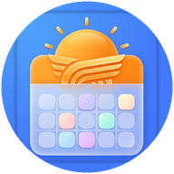

# iYango

面向阳光学院的本地优先 Android 校园课表与教务助手

---

## 下载安装

前往 [Releases](https://github.com/gfs114/iYango/releases/latest) 下载 `iYango-release.apk`（支持 Android 8.0 及以上），安装后可在应用内「版本更新」页检查并下载新版。

## 核心功能

- **课表与日程**：今日日程、周课表网格/时间轴双视图、多课表管理与双人实时对照（今日状态、共同空闲、双人周视图）、单双周与单次调课、法定节假日与调休感知、学期数据海报
- **教务集成**：阳光学院教务登录与课表同步、成绩与 GPA / 学分进度统计、实时空教室查询
- **提醒与静音**：课前提醒、上课自动静音/免打扰与定时恢复、系统日历同步、Android 16+ 实时进度与出分 Live Update、多尺寸桌面小组件与快捷磁贴
- **AI 助理与导课**：自带 Key 接入 OpenAI / Anthropic 接口，支持流式对话、课表/成绩/空教室查询与二次确认改课，以及拍图或粘贴文本识表导入
- **导入导出与同步**：支持 ICS / WakeUp / CSV / JSON 导入导出、口令分享与二维码扫码/相册识码、WebDAV 加密云备份同步
- **外观与更新**：Liquid Glass 液态玻璃材质、静态与动态壁纸（支持本地视频与 `.mpkg`/`.pkg`/`.zip`/`.tex` 壁纸包导入）、自定义强调色与字体、内置版本更新页（支持下载镜像切换与历史版本查看）

## 更新日志

### v1.3
- 优化应用更新检测与历史版本加载：新增多线路自动回退（GitHub API、代理静态清单 `update-manifest.json`、Atom 订阅与镜像轻量接口），不再强依赖直连 `api.github.com`
- 优化检查更新交互：在「关于与反馈」与「版本更新」页点击检查更新发现新版本时直接弹出更新内容弹窗
- 将 DNS 解析失败、连接超时与 HTTP 异常转换为清晰的中文提示

### v1.2
- 新增双人课表实时对照：支持绑定对照课表与自定义称呼，今日页展示双方实时上课状态、同步下课提示与共同空闲时段，周课表支持单人/双人视图切换并联动空教室查询
- 新增动态壁纸导入与播放：支持本地 MP4 / WebM 视频与 `.mpkg` / `.pkg` / `.zip` / `.tex` 壁纸包流式提取，基于 Media3 ExoPlayer 静音循环播放并附首帧防闪黑
- 优化液态玻璃底栏折射与选中态表现，应用内更新弹窗改为仅展示清洗后的变更日志正文

### v1.1
- 新增独立版本更新页，支持下载镜像切换、历史版本查看与应用内下载安装
- 收拢考试入口并优化多 Activity 页面导航体验

### v1.0
- 首发版本：支持阳光学院教务同步、自动静音与免打扰、法定节假日调休感知、WebDAV 加密云同步、多格式导入导出与课表时间轴视图

## 隐私与安全

- **本地优先**：课表、成绩与设置均存储在本机，云同步仅在主动配置 WebDAV 后启用
- **加密凭据**：教务密码、WebDAV 凭据与 AI API Key 使用系统 Keystore 加密保存，不进入系统备份
- **直连请求**：AI 请求由设备直接发往用户配置的接口地址，不经过中转服务器

## 许可与声明

- 本项目基于 [MIT 许可证](LICENSE) 开源
- 液态玻璃材质基于 [Kyant0/AndroidLiquidGlass](https://github.com/Kyant0/AndroidLiquidGlass)（Apache-2.0）；学分进度分类思路参考 [XJAU-Helper](https://github.com/FengHDSL/XJAU-Helper)（MIT）
- 本项目为非官方校园辅助工具，教务同步依赖学校教务页面结构；请遵守学校网络使用规范，自带 AI 接口产生的调用费用由用户自行承担
