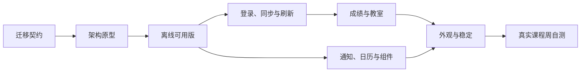

# iYango Android 开发任务清单

版本：1.0｜日期：2026-10-24｜状态：规划，所有开发项尚未执行。

主方案：[架构与开发实施方案](./iYango-Android架构与开发实施方案.md)。验收方法：[独立自测手册](./iYango-Android自测手册.md)。

目标是先做能自行安装、保留数据并长期使用的 Android 版。商城上架、商店账号和提交材料不在当前清单内。此清单不表示已经创建 Android 工程；现有鸿蒙项目保留。

## 1. 使用方法与阶段关系

完成一个任务，需要同时具备相应产物和通过证据。复选框表示完成状态，不表示“代码已经写了一半”。构建成功、安装成功、真机视觉通过、真实提醒通过分别记录。

建议每个任务附：负责人、关联提交或源码快照、测试用例、结果、遗留问题。没有真机或学校账号时可继续其他独立任务，对应验收保留“未验证”。



P5 的原型可在 P2 后开始，不必等学校接口全部完成；最终验收要覆盖 P3/P4 的同步变更。P6 的布局和安全要求从 P1 就开始落实，不能留到最后返工。P7 的连续使用记录是自然时间，自测也要穿插在前面每一阶段。

任务编号如 P2-03 只用于跟踪；自测编号如 S04、X02 对应独立手册第 7 节。

## 2. P0：迁移契约与准备

前置：只读核对当前鸿蒙源码与已确认需求，不修改现有工程。

- [ ] **P0-01 功能盘点**：逐页记录今日、课表、成绩、我的和二级页面的入口、成功/空/错误状态；把已有实现、待验收能力、未来扩展分栏。
- [ ] **P0-02 规则样例**：建立 D01–D07、D11 的虚构数据和预期实例；覆盖单双周、指定周、循环周、单次停课/调课、日期事件、未知时间。
- [ ] **P0-03 字段对照**：形成 ArkTS 模型 → Kotlin 业务模型 → Room 字段 → JSON 字段表；明确星期起点、ID、覆盖引用、时区、原始节次与展示钟点。
- [ ] **P0-04 学校协议样例**：在获准的已有响应或正常个人操作中整理脱敏 HTML/JSON；记录页面结构、分页、登录失效、课程/借用详情归属，不收集真实密码/Cookie。
- [ ] **P0-05 数据保护契约**：定案多课表、账号切换、登出、学校同步、文件替换和删除范围；学校表与手动表隔离。
- [ ] **P0-06 系统输出契约**：定案 occurrenceId、payloadHash、planRevision、当前课表提醒范围、默认提前 10 分钟、日历归属与恢复语义。
- [ ] **P0-07 开发环境清单**：选定实际 Android 自测设备、API 范围、IDE/JDK/SDK/AGP/Kotlin 兼容组合，记录版本；不把鸿蒙工具链视作可直接通用。
- [ ] **P0-08 身份与签名**：固定 Android applicationId、debug 后缀、namespace、长期 release 签名保管规则；鸿蒙包名与 Profile 不改动。
- [ ] **P0-09 架构决策记录**：完成主方案建议的 6 份 ADR，每份写取舍与重新评估条件。

交付物：迁移矩阵、字段契约、fixtures 与预期输出、版本表、ADR。通过条件：后续实现人员无需再猜“什么是同一门课程”“同步能改哪些表”“一次调课如何关联原课程”。缺少真实响应的协议分支列为待核实，不能编造接口。

## 3. P1：架构原型与最小可运行工程

前置：P0 的路线、模型身份和签名策略已定。

- [ ] **P1-01 独立工程**：在新的 Android 目录创建工程；使用 Gradle Wrapper、Version Catalog 和固定依赖版本，避免污染鸿蒙目录。
- [ ] **P1-02 七个模块**：建立 app、core:model、core:domain、core:designsystem、data、feature:main、platform:android，核对单向依赖图。
- [ ] **P1-03 纯业务边界**：core:model/domain 能运行 JVM 单测；不引入 Android Context、Room Entity、Composable、系统资源 ID。
- [ ] **P1-04 依赖组装**：在 app 绑定 Repository 与平台接口；各实现可由 Fake 替换，不用全局单例传递页面状态。
- [ ] **P1-05 数据原型**：建立 Room、schema 导出和一个虚构课表；通过 Repository Flow 同时显示今日与周课表。
- [ ] **P1-06 页面骨架**：单 Activity、四主页导航、类型化目标、基础主题、空态和错误态；未完成页面清楚标识。
- [ ] **P1-07 状态结构**：ViewModel 持有不可变 UiState，区分首次加载/保留旧数据刷新/失败；轻量路由与筛选可恢复。
- [ ] **P1-08 调试与稳定配置**：debug 可使用假数据，release 关闭调试入口与敏感日志；两种 applicationId 和签名配置可辨认。
- [ ] **P1-09 纵向平台原型**：用 Fake 计划和独立测试设备验证一条本地通知、一个 Widget、一次可恢复日历写入的可行性；此原型不代表 P5 全部验收。
- [ ] **P1-10 最小构建验证**：运行有效单测、lint、debug 构建并安装到 Android 设备；记录实际执行数和产物身份。

交付物：可运行原型 APK、模块依赖记录、最小测试报告。通过条件：改一次数据库中的课程，两个页面自动更新；平台适配不引用页面 ViewModel；缺少网络仍能启动。对照 A01/A02、N01/N03。

## 4. P2：离线核心，达到可以开始自用

前置：P1 的数据流和依赖方向通过。

- [ ] **P2-01 数据库完整性**：建立课表、学期、时间表、课程、调整、导入记录及任务表；约束、索引和外键符合契约。
- [ ] **P2-02 课程发生引擎**：实现日期范围内实际实例计算，统一首页、课表、冲突、提醒与组件的数据来源。
- [ ] **P2-03 规则对照**：对 D04–D07 比较完整日期/时间/身份结果；不能仅比较课程条数；测试跨年与设备时区变化。
- [ ] **P2-04 多课表**：创建、切换、重命名、分组、删除；当前课表持久化，绑定对象独立。
- [ ] **P2-05 课程编辑**：新增/修改/删除，时间与周次校验，颜色、备注、教师/教室；保存失败不丢草稿。
- [ ] **P2-06 单次调整**：明确停课/调课对象、原始发生日期及稳定实例身份；修改后不生成重复原课。
- [ ] **P2-07 今日页**：当前课程、今日列表、明日安排、月历、快捷入口与空态；不启用周期联网。
- [ ] **P2-08 周课表**：周切换、滚动、时间轴、冲突、课程详情；手机/平板、横屏和最后一行可操作。
- [ ] **P2-09 学期与钟点**：自定义时间表与校区差异；未知时间显式提示；第十一节显示与原始 11–12 协议含义分开。
- [ ] **P2-10 JSON 导入**：支持当前 ClassSchedule v1，预览、ID 映射、新建/替换、重复文件提示、整批回滚；合并按钮暂不开放。
- [ ] **P2-11 JSON 导出**：完成可恢复备份与往返对照；不导出凭据、系统绑定 ID、私有壁纸路径；未经双端对照不宣称双向无损。
- [ ] **P2-12 待协调任务**：业务修改与任务入队同一个 Room 事务；崩溃重启后继续处理，旧版本任务不能确认新版本完成。
- [ ] **P2-13 迁移基线**：保存首版 schema 和测试数据库；建立覆盖升级流程，禁止稳定包破坏性迁移。
- [ ] **P2-14 离线自用验收**：形成签名自用 APK，执行手册冒烟、S01–S10、I01–I05、X01–X03 与覆盖升级演练。

交付物：离线自用 APK、JSON 样例、课程引擎报告、覆盖升级记录。通过条件：无网络可完整管理课表，备份能恢复，调课和停课正确，反复启动不丢数据。在线能力未做完时保留明确入口状态。

## 5. P3：学校登录、同步与统一刷新

前置：P2 数据层可靠；P0 协议证据可用。

- [ ] **P3-01 学校 HTTP 客户端**：独立超时、重定向、Cookie、域名约束和错误分类；不与自有后端客户端混用会话。
- [ ] **P3-02 登录解析**：根据当前学校页面验证控制器、动态字段和成功标识；不照搬其他学校部署，也不将 HTTP 200 等同成功。
- [ ] **P3-03 官方网页备用**：实现受控 WebView 登录、Cookie 交接、受信域跳转与关闭恢复；release 禁止 WebView 调试。
- [ ] **P3-04 凭据保护**：Keystore 密钥 + 私有密文，处理密钥不可用与重新登录；不迁移 XOR/Base64 密码混淆方案。
- [ ] **P3-05 账号状态**：账号范围、session revision、正在登录与正在同步互斥；登出清会话/在线缓存而保留离线课表。
- [ ] **P3-06 绑定同步**：按 schoolId/accountScopeId/termKey 找目标；全量校验后事务提交，保持当前课表和手工课程。
- [ ] **P3-07 本地调整保留**：学校原始课程与本地覆盖分离；来源消失或匹配不唯一时提示待处理，不静默丢调整或生成不确定提醒。
- [ ] **P3-08 刷新协调器**：冷启动等初始化完成；真实进程后台返回产生新 generation；首页/成绩/课表下拉等待实际轮次。
- [ ] **P3-09 并发与失效**：同 generation 合并相同任务；跨 generation 新轮次重新执行；旧请求不写入新账号/筛选，不关闭新圆圈。
- [ ] **P3-10 故障注入**：MockWebServer 验证登录页假成功、超时、重定向、Cookie 轮换、取消、部分数据与登录争锁。
- [ ] **P3-11 真实学校验收**：自行用合法账号验证登录、同步、过期和再登录；保留脱敏证据，不用真实服务做并发压力测试。

交付物：学校适配器、会话状态说明、刷新并发报告、真实操作记录。通过条件：L01–L07、R01–R06、S07、X04 通过；异常请求不损坏已有课表；主动输入账号和密码后的按钮状态符合需求。

## 6. P4：成绩与教室查询

前置：P3 学校会话与统一刷新有效；页面仅依赖领域接口。

- [ ] **P4-01 成绩条件**：草稿/已确认条件分离，学年/学期编码正确；全年结果未完整取得不发布为完整成功。
- [ ] **P4-02 成绩结果**：排序、记录详情、缓存身份、统计口径；无学分、等级、重修、缺失绩点不强行补数字。
- [ ] **P4-03 成绩刷新**：保留旧有效数据并提示失败，圆圈在标题内容下可见；切账号清除不适用缓存。
- [ ] **P4-04 离线成绩边界**：首版先实现进程内缓存；若纳入持久化，新增快照表、账号/学期隔离、时间和完整性标识，并增加对应测试后再标完成。
- [ ] **P4-05 校区与楼宇**：全部校区聚合、编码去重、部分失败状态、名称搜索；切校区同步处理原选中楼宇。
- [ ] **P4-06 教室筛选**：周次、星期、节次与弹层草稿；默认所有所选时段全部空闲，未知和未查询不当空闲。
- [ ] **P4-07 使用情况矩阵**：上课、借用、空闲、未知分别显示；长名称、小屏与大屏可读可点。
- [ ] **P4-08 第十一节详情**：展示第十一节 20:10–20:55，保留后端 11–12 原始编码/时间匹配信息，不能为消除错误关闭归属校验。
- [ ] **P4-09 详情请求身份**：房间、周、日、节次与请求轮次绑定；关闭/切换详情后旧结果不得覆盖。
- [ ] **P4-10 页面缓存失效**：隐藏且已有条件的查询下次进入重刷；从未访问教室页时不全校扫查；不恢复已要求删除的更新时间展示行。
- [ ] **P4-11 功能验收**：执行 G01–G06、C01–C07；分别核对假响应和真实学校结果，记录网络前提。

交付物：成绩/教室功能包、查询契约、真实协议记录。通过条件：筛选显示与结果身份一致，未知状态不会误导为空教室，最后时段正常返回正确归属详情。

## 7. P5：通知、系统日历与桌面组件

前置：P2 课程引擎和任务事务通过；完整验收还依赖 P3 同步变更。

- [ ] **P5-01 统一提醒计划**：从同一课程实例引擎生成剩余学期计划；当前课表、提前分钟、静音课程和稳定 ID 契约生效。
- [ ] **P5-02 权限状态**：分别检测通知权限、通知 Channel、精确闹钟、日历权限；开关与系统能力不混为一谈。
- [ ] **P5-03 本地通知调度**：AlarmManager 调度最近有效提醒，触发后接力；同一时刻多课正确处理，PendingIntent 身份不碰撞。
- [ ] **P5-04 无精确权限处理**：首版明确暂停应用通知通道并提供授权/日历入口，不静默改成可能延迟的提醒。
- [ ] **P5-05 系统恢复**：重启、升级、日期/时区变化、权限变化、删除/停课/调课后重排；旧任务不复活已取消计划。
- [ ] **P5-06 后台补偿**：WorkManager 只做可延迟协调与恢复，不承担课前精确触发，不为避免后台限制常驻服务。
- [ ] **P5-07 日历选择**：列出可写目标、说明云日历影响；无可写日历或拒绝权限时基本课表继续可用。
- [ ] **P5-08 日历幂等恢复**：验证 Provider 可保存归属标记；系统插入后、本地映射前崩溃能接管唯一事件；无法唯一识别则待确认，不能猜测删除。
- [ ] **P5-09 日历更新与清理**：剩余学期分批写入，调整只改归属事件，关闭通道/目标日历丢失按契约处理；个人同名事件保持完整。
- [ ] **P5-10 四种 Widget**：课程预告、两种今日课程、周标尺分别布局；Glance UI 与应用内 Compose UI 分开实现。
- [ ] **P5-11 Widget 持久配置**：每个 appWidgetId 单独记录课表策略、样式和显示项；变尺寸、进程死亡、重启可恢复。
- [ ] **P5-12 Widget 更新与跳转**：本地数据变化后主动更新、系统周期补充；点击可冷启动到正确实例，数据删除有兜底。
- [ ] **P5-13 透明与可读性**：实体、半透明、透明方案在真实壁纸下核对；不复用鸿蒙权益申请结论。
- [ ] **P5-14 系统能力验收**：执行手册第 8–10 节，保留前台/后台/锁屏/重启/强停/连续多日记录和真实桌面截图。

交付物：独立的通知报告、日历报告、Widget 报告。通过条件：每个通道分别验证，不能用日历成功替代通知验收；自动日历恢复未验证时只开放已验证的手动 Intent 路线，并将自动同步标为未完成。特定设备限制如实记录。

## 8. P6：外观、隐私、升级与稳定自用包

前置：核心路径可用；以下要求须在早期设计中落实，本阶段补齐矩阵。

- [ ] **P6-01 统一顶部几何**：背景绘制到状态栏，标题和按钮避让系统区域；视觉效果开关不改变内容安全距离。
- [ ] **P6-02 下拉刷新几何**：今日/成绩/课表轻拉即可看清圆圈；嵌套滚动、手势和加载结束状态正确。
- [ ] **P6-03 自适应窗口**：手机、平板、横屏、分屏、小窗口布局；不以锁方向代替适配。
- [ ] **P6-04 外观设置**：主题、字体、颜色、壁纸裁剪与显示项；重启后保存，图片受控解码，避免大图内存峰值。
- [ ] **P6-05 可访问性**：读屏语义、触控目标、对比度、放大字体；状态除了颜色还有文字含义。
- [ ] **P6-06 文件与权限**：系统文件选择器/内容 URI；不为导入或壁纸申请全盘访问；权限拒绝与撤回正常恢复。
- [ ] **P6-07 备份排除**：课程数据库、凭据、系统输出映射、私有壁纸按首版策略排除系统备份/迁移；对目标版本和设备验证。
- [ ] **P6-08 安全复核**：release 无密码/Cookie/完整敏感响应日志、无调试 WebView、无开发 HTTP 服务器地址；学校必要协议例外需明确最小范围。
- [ ] **P6-09 数据库升级**：从历史 schema 自动迁移，并在旧稳定 APK 上真实覆盖安装；用户数据、组件和计划关系完整。
- [ ] **P6-10 性能记录**：冷启动、切周/滚动、图片、重复开关页面、网络请求数、静置电量；记录设备与实际测量工具。
- [ ] **P6-11 release 验证**：以实际收缩/混淆配置构建签名 APK，执行有效 lint/测试、覆盖安装和离线恢复；不以 debug 结果代替。
- [ ] **P6-12 交付归档**：APK、SHA256、签名证书指纹、版本/源码快照、测试报告、限制清单、可读 JSON 备份；密钥和密码另外保管。

交付物：稳定自用包及可追溯证据。通过条件：U01–U05、P01–P04 和手册升级流程通过；所有未完成环境注明，不能写成“全机型适配”。

## 9. P7：独立自测与日常使用观察

前置：有可保留数据升级的稳定自用包。详细步骤以独立自测手册为准。

- [ ] **P7-01 建立设备台账**：记录 Android 版本、品牌、屏幕、Launcher、通知/闹钟/日历授权和省电状态。
- [ ] **P7-02 完整功能矩阵**：逐项执行手册功能表；针对每次改动选择相关回归，不把“未执行”改成“通过”。
- [ ] **P7-03 真实课程周**：至少连续一轮真实课程周，记录每日今日/周课表/Widget 是否一致，提醒是否重复或漏发。
- [ ] **P7-04 离线与异常恢复**：断网、超时、会话过期、后台切换、进程回收、低内存与部分写入；失败不抹除有效数据。
- [ ] **P7-05 覆盖升级复测**：用含课程、调课、主题、提醒和多个 Widget 的旧包升级，核对完整状态。
- [ ] **P7-06 数据恢复演练**：先在开发包或测试设备验证 JSON 恢复，确认有效后才把它作为日常备份；不清空主力数据演练。
- [ ] **P7-07 缺陷闭环**：最短复现、期望/实际、版本、截图/日志、修复后证据成对保存；不覆盖原失败记录。
- [ ] **P7-08 自用结论**：分别给出“离线可用”“在线功能可用”“通知已验证”“日历已验证”“组件已验证”和未覆盖环境。

交付物：独立自测记录、真实课程周日志、缺陷与限制清单。通过条件：承诺能力均有证据；影响数据或核心课表的缺陷解决后才日常依赖。商城审核不在这一关内。

## 10. 首轮开发建议：先完成哪几个任务

先安排 P0-01/02/03/05/06/08/09，确定会影响返工的契约；随后建立 P1 原型并用一个虚构课程贯通数据流。工具安装与版本核对按 P0-07 执行，不能默认当前电脑已经具备 Android 环境。

接着优先完成 P2 的课程引擎、JSON 往返与编辑，形成可以独立使用的离线包。学校登录与系统能力分别推进；它们不应成为本地课表能否打开的前提。

当前最不值得提前投入的是上架材料、全平台共享框架、课程云同步、复杂动效和全功能一次成型。这些不进入首轮验收；后续需求确认后另开任务，避免平台迁移中途失去可用版本。

## 11. 单个任务的完成记录模板

```text
任务 ID / 名称：
本次范围：
依赖任务及状态：
实现位置 / 源码快照：
实际产物：
自动化检查（数量、结果、报告）：
构建（类型、版本、签名、SHA256）：
安装与覆盖升级结果：
真机功能 / 视觉 / 提醒 / 日历 / Widget 分项结果：
未验证范围与原因：
关联缺陷及修复证据：
是否满足本任务通过条件：
```

未来新增需求先在主方案中修改范围或契约，再补清单与用例，保持三份文档一致。本文所有复选框目前均为空；不要把本轮文档交付当作对应开发任务已完成。
