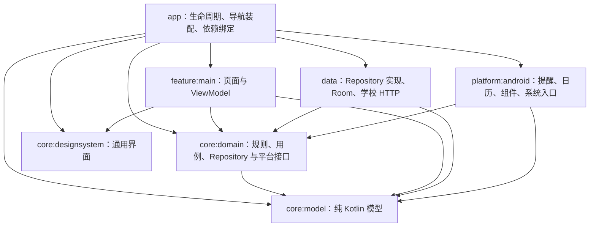

# iYango Android 架构与开发实施方案

版本：1.0｜编写日期：2026-10-24｜性质：实施规划，不代表 Android 版本已经开发或通过测试。

本方案依据当前鸿蒙源码 G:/code/openHarmony/ClassSchedule-exp（iYango_prelease）及本轮需求编写。保留现有鸿蒙项目；本轮只生成文档，不创建 Android 工程、不改业务代码、不操作设备。

**当前目标：先做可以自行安装、长期使用和测试的 Android 版本。** 国内应用商店与 Google Play 是未来可能的渠道，暂不作为首版开发或验收前提。本文只提前保留会影响返工的包标识、签名、依赖和数据边界。

配套文件：

- [独立自测手册](./iYango-Android自测手册.md)：测试包、安装升级、测试数据、真机用例、提醒验证、日志和验收记录。
- [开发任务清单](./iYango-Android开发任务清单.md)：按阶段拆分的工作项、依赖、交付物与通过条件。

阅读顺序：先看第 1、3、5 节，确定路线、范围和模块；第 6–10 节确定数据与同步契约；第 11–17 节逐项安排页面和系统能力；第 18 节用于排期。实际开工按任务清单执行，准备安装包后按独立自测手册逐项留证。

## 1. 架构结论：最适合现在的 iYango 的方案

**推荐采用 Android 原生 Kotlin + Jetpack Compose，应用内部使用 MVVM + 单向数据流，配合轻量 Clean 分层、按业务组织代码、渐进式 Gradle 模块化、本地数据优先。**

这是一套相互配合的选择，不是把几个架构名字并列使用：

| 决策层面 | 推荐选择 | 对 iYango 的具体作用 |
| --- | --- | --- |
| 平台实现 | 原生 Android / Kotlin | 直接处理通知、闹钟、日历、桌面组件、WebView、生命周期和大屏适配 |
| 界面框架 | Jetpack Compose | 重写四个主页和原生交互，使用状态驱动界面 |
| 页面组织 | MVVM | ViewModel 负责页面状态和用户操作；Composable 负责显示与事件上报 |
| 状态流转 | 单向数据流 UDF | 数据生成 UiState；用户意图向上提交；不允许页面与后台服务各自修改一份课程真相 |
| 业务分层 | 轻量 Clean Architecture | 把课程计算、调课、提醒规划等规则独立出来；只为复杂、可复用流程建立用例 |
| 代码组织 | 业务包 + 初始 7 个 Gradle 模块 | 建立边界，同时避免首版拆成几十个难维护的模块 |
| 数据策略 | 本地优先 | 已有课表离线可用；网络同步成功后更新本地数据，再驱动界面与系统能力 |
| 运行环境 | 核心功能不依赖 GMS | 不安装 Google 服务的设备也能看课表、查询教务、接收本地提醒、使用桌面组件 |
| 后端策略 | Android 首版不新建课表云后端 | 复用学校数据源与本地存储边界；已有账号/设置后端单独评估 |

Google 的架构建议支持分层、单向数据流、Repository 和合适的状态持有者，也明确领域层应按复杂度与复用需求引入。本文的“7 个模块、哪些规则抽离、哪些模块暂合并”是针对 iYango 的工程判断，不是官方规定。[Android 架构建议](https://developer.android.com/topic/architecture/recommendations)

### 1.1 为什么原生最合适

iYango 的复杂度不只在页面。它需要同一套课程规则同时服务今日页、周课表、冲突检查、提醒、日历与桌面组件，还要处理学校会话失效、Cookie 轮换、后台恢复以及厂商电源策略。原生路线能减少这些能力之间的桥接层，出问题时也更容易追踪到 Android 的实际状态。

现有 ArkTS/ArkUI 页面不能直接编译成 Android 页面。无论选 Kotlin 还是 Flutter，都需要重新实现界面。因此，不能用“已经有一套界面，换框架就能直接复用”作为选型前提。

### 1.2 方案比较

以下是结合本项目的判断，不是通用性能排名。

| 方案 | 优点 | 对本项目的成本或风险 | 本轮结论 |
| --- | --- | --- | --- |
| Kotlin + Compose | Android 系统集成直接；生命周期、后台、组件和调试链清楚 | 需要维护鸿蒙和 Android 两套平台界面 | **首选** |
| Flutter | 如果未来同时重做 Android/iOS，部分 UI 与业务可共享 | ArkTS 仍需重写；桌面组件、提醒、日历、原生登录等仍要插件或原生桥接；增加 Dart 与 Kotlin 两侧排错 | 暂不作为首选；明确要近期同时做 iOS 时再重新比较 |
| Kotlin Multiplatform + 平台 UI | 可以逐步共享 Kotlin 业务逻辑，适合明确的 Android/iOS 双端计划 | 当前业务是 ArkTS，不会自动变成 Kotlin 公共代码；平台适配、工具链和测试成本仍存在 | 先把领域层写成不依赖 Android 的 Kotlin，未来再评估提取 KMP |
| React Native | 有 Web/React 团队时较易组织界面开发 | 当前不是 React 项目；系统能力仍要桥接，不能直接复用 ArkUI | 不选 |
| WebView 包装 / PWA | 简单内容页上线快 | 核心离线规则、精确提醒、桌面组件和大屏交互需要大量额外实现 | 不适合作为 iYango 完整安卓版 |

Flutter 支持通过平台通道连接原生代码；这说明它能做系统能力，但不意味着系统工作量消失。KMP 官方资料列举 Android、iOS 等支持目标，也不能据此推断现有 HarmonyOS ArkTS 可直接共享。[Flutter 平台通道](https://docs.flutter.dev/platform-integration/platform-channels)、[Kotlin Multiplatform](https://kotlinlang.org/multiplatform/)

### 1.3 为什么不采用“完整重型 MVI + 每层都拆模块”

可以借鉴 MVI 的不可变状态和明确事件，但首版不引入全局 Store、全应用 Reducer、通用 BaseViewModel、万能 EventBus 等框架。它们容易把一个简单的课程编辑操作变成跨多层跳转。

以成绩筛选为例，只需在页面状态中区分“正在选择的条件”和“已确认查询的条件”，确认后发起查询，并保留明确的加载、成功、失败状态。没有必要为了这个流程维护一套通用状态机框架。

领域层也不是每一个数据库读取都必须再包一个 UseCase。课程发生规则、调课、同步提交、导入事务、提醒规划应独立；简单设置读写可以直接经由 Repository 接口访问。

## 2. 当前鸿蒙版本有哪些内容需要迁移

下表依据本轮读取的源码。**“存在实现”不等于每项已经完成所有真机验收。** Android 需要重新实现与验证，不能继承鸿蒙构建通过的结论。

| 功能 | 当前依据 | Android 工作 |
| --- | --- | --- |
| 今日页 | TodayView、ScheduleQueryService | 今日课程、明日安排、个人资料、快捷入口、月历、空态和错误态 |
| 周课表 | SchedulePage、ScheduleGrid、ScheduleLayoutMetrics | 周切换、时间轴、课程块、冲突、滚动和手机/平板适配 |
| 多课表 | TimetableRepository、TimetableModels | 本地课表与教务课表分开；当前课表、分组、循环规则、显示设置 |
| 课程编辑 | CourseEditPage、CourseEditDraft、CourseEditHistory | 创建、编辑、删除、校验、单次调课与停课 |
| 课程规则 | CourseScheduleRules、CourseExtras | 单双周、指定周、循环周、自定义时间、日期事件、覆盖关系 |
| 教务登录 | IYangoLoginPage、YguDirectLogin、YguWebLoginSession | 直接 HTTP 登录与官方网页备用流程；安全存储和账号切换 |
| 教务同步 | YguQuickSync、YguAutoSync、YguScheduleSync | 校验完整结果、更新账号绑定课表、保留手动课表与旧数据 |
| 成绩 | YguGradesAvailability、Controller、GradesView | 学年/学期筛选、排序、统计、详情、错误恢复与账号隔离 |
| 教室查询 | ClassroomQueryPage、YguClassroom 系列 | 校区/教学楼联动、找空教室、使用情况、课程及借用详情 |
| 统一刷新 | AppRefreshService、AppRefreshSignal | 启动和后台返回刷新；首页下拉；并发合并、失效保护 |
| 课程提醒 | CourseReminderPlanner、Service、Platform | 通知和系统日历双通道；平台层必须完全重写 |
| 桌面卡片 | 4 个 widgets 页面、EntryFormAbility | 四种信息结构迁移到 Android App Widget；配置、更新和点击跳转 |
| 透明卡片 | form_config 中 4 个透明变体 | 鸿蒙权益与 Android 无直接对应关系；Android 独立验证透明背景及可读性 |
| JSON 导入导出 | ScheduleJson、Parser、Service | 保持旧格式兼容；迁移标识、扩展字段和引用关系 |
| 外观 | ThemeManager、AppearancePrefs、壁纸与显示配置 | 明暗主题、主题色、壁纸裁剪、字体和布局选项 |
| 本地数据库 | DbSchema | 现有 RDB schema 版本为 3；Android 另建 Room schema，不直接拷贝数据库 |
| 账号/设置服务端 | server 源码、AuthService、SettingsService | 评估是否接入；不是课表云同步服务，也未证明有可用生产部署 |

### 2.1 已讨论但不能当作现成能力的项目

- 考试安排：本轮没有发现独立模块，列为后续扩展。
- 同步变更记录：有同步过程，不等于已有面向用户的变化列表；需要新增差异模型。
- 成绩离线持久化：当前 Availability 主要是进程内缓存。Android 若支持退出后离线查看，是新增的数据持久化工作。
- 课表图片分享、ICS 导出：列为扩展，不冒充已有 JSON 导出能力。
- 课程实况窗：当前没有已完成的交付结论，不纳入首版必做。
- 真正透明的鸿蒙卡片效果：此前仍受权益/Profile 限制；不可把该结果写成 Android 的验收依据。

### 2.2 现有代码能复用什么

可复用的是规则、字段含义、解析边界、交互要求、脱敏样例与测试预期。图片、图标、字体需要核对来源和使用权后再复用。Java 服务端如确实需要，可独立复用协议与服务；不需要随 Android 重写一遍。

需要改写的是 ArkUI 页面、装饰器状态、AppStorage、RDB 调用、ArkWeb、Want 路由、FormExtensionAbility、鸿蒙通知/日历/资产存储 API。不要机械地把每个 .ets 文件翻译成一个 .kt 文件，先确定职责与数据契约。

## 3. 首版范围与分期

### 3.1 可以开始自己用的最小版本

必须具备：四个主入口的基本导航；离线课表；多课表隔离；课程编辑；学期和时间表；JSON 导入导出；今日页；手机及平板基本布局；无数据丢失的覆盖升级。此时教务可以暂未完成，使用脱敏课表文件和手动课程即可验证架构。

### 3.2 功能对齐版本

在上面的基础上增加：教务登录与同步、成绩、教室查询、启动/前台刷新、通知提醒、系统日历、四种桌面组件、外观设置、异常与授权状态。这个阶段才接近现有 iYango 的完整 Android 体验。

### 3.3 暂不增加的工作

首版不同时建设新课表云服务器，不引入跨设备实时同步，不强制接入 Google 登录、FCM、厂商推送或统计 SDK，不把考试/变更记录/图片分享等扩展与平台迁移绑在同一批验收中。

如后续确认 iOS 是近期目标，应在网络和平台层大量实现之前复议 KMP；否则按照本方案先做 Android，领域边界保留未来选择空间。

## 4. 推荐技术栈与版本策略

| 类别 | 选择 | 使用边界 |
| --- | --- | --- |
| 语言 | Kotlin | 业务和 Android 实现统一语言 |
| UI | Compose + Material 3 | Material 提供控件和可访问性基础，视觉仍保留 iYango 品牌 |
| 导航 | 单 Activity + 类型化 Navigation Compose 路由 | 先选定一套路由方案，不混用两套主导航系统 |
| 状态 | ViewModel、StateFlow、不可变 UiState | 按生命周期收集状态；临时动画状态保留在 UI 层 |
| 异步 | Coroutines / Flow | 结构化并发；明确取消、超时、错误分类 |
| 依赖注入 | Hilt + 构造器注入 | Android 组件在外层绑定；纯领域类不依赖 Android 容器 |
| 结构化存储 | Room / SQLite | 课表、课程、绑定、导入记录及未来的成绩快照 |
| 小型偏好 | DataStore | 主题、排序、显示选项；不保存密码和 Cookie 明文 |
| 凭据 | Android Keystore + 经过审查的加密存储封装 | Keystore 保护密钥，应用私有目录保存密文 |
| HTTP | OkHttp | 独立学校客户端、Cookie 策略、重定向和超时；普通自有 API 可在其上使用 Retrofit |
| 序列化 | kotlinx.serialization | 版本化备份与受控 DTO；HTML 不按 JSON 处理 |
| HTML | 经过验证的解析器，例如 jsoup | 避免整页正则堆叠；特殊学校字段仍用明确规则解析 |
| 图片 | Android 图片解码 + 合适的图片加载库 | 限制尺寸、内存、EXIF 方向、文件权限；不上传壁纸 |
| 后台工作 | WorkManager | 可延迟的重算、补偿、组件更新；不充当精确课前闹钟 |
| 课前提醒 | AlarmManager + NotificationManager | 权限检测、时区、重启恢复、失效清理 |
| 日历 | Calendar Provider / Calendar Intent | 自动同步与用户逐条确认是不同能力 |
| 桌面组件 | Jetpack Glance，必要时局部 RemoteViews | 复用数据和规则，不能直接复用应用内 Compose 控件 |
| 测试 | JUnit、协程测试、Room 测试、MockWebServer、Compose UI 测试 | 业务测试尽量不依赖真机和学校在线服务 |
| 构建 | Gradle Wrapper + Version Catalog | 所有可执行构建依赖锁定版本，不使用动态版本号 |

Room 适合结构化、可查询、需要迁移的数据；DataStore 用于偏好，不能把课程表变成一个巨大偏好 JSON。[Room](https://developer.android.com/training/data-storage/room)、[DataStore](https://developer.android.com/topic/libraries/architecture/datastore)

Hilt 用于组装实现；测试可以替换 Repository、时钟和调度端口。[Hilt](https://developer.android.com/training/dependency-injection/hilt-android)

版本约束建议：

1. minSdk 暂建议 26（Android 8.0），这是本项目维护范围建议，不是商店硬性要求；先核对你实际自测设备，必要时调整。
2. targetSdk 起点不低于 36，compileSdk 不低于 targetSdk。建项时以当前稳定 SDK、Android Gradle Plugin、Kotlin 与 Compose 的兼容组合定版，不凭印象填“最新版本”。
3. Android Studio 使用稳定版及与 AGP 兼容的 JDK；优先使用 IDE 配套运行时并记录版本，避免复用 DevEco 的 Java/Node 设置去猜 Android 环境。
4. 文档不宣称某个依赖小版本是最新；在真正建工程当天生成版本表，并验证一次空工程编译、安装和 Compose 页面启动。
5. 初期不引入 NDK；如未来依赖包含原生 .so，要单独验证 ABI、页大小和平台兼容要求。

目前官方 Google Play 页面写明，自 2026-08-31 起手机/平板新应用及更新要求 target API 36 或以上。这里仅用来避免选定过旧的起点；你当前不上架，未来提交时仍需重新核实。[官方 target API 要求](https://support.google.com/googleplay/android-developer/answer/11926878?hl=en)

## 5. 分层和模块：工程应该怎样摆放

### 5.1 依赖方向



箭头表示“编译依赖”，不是运行时网络方向。Repository 接口位于领域侧，实现位于 data。平台服务实现领域接口，通过 app 的依赖绑定获得数据访问能力；平台模块不直接依赖某个页面。**没有 feature → data 的直接依赖，也没有 data ↔ platform 的相互依赖。**

接口与实现的 Hilt 绑定集中在 app；因此 app 显式依赖 core:domain、core:model、core:designsystem，不能依靠其他模块的 implementation 依赖间接访问类型。组件只共享必要的领域数据和无平台语义的设计数值，不依赖 design system 中的 Compose 控件。若将来单独提取设计数值模块，先通过 ADR 决定，本版不增加第八个模块。

### 5.2 首批 7 个模块

```text
iYango-android/
  app/                    应用入口、导航根、依赖装配、构建与签名配置
  core/model/             业务 ID、课程/学期/查询模型、错误类型
  core/domain/            课程规则、复杂用例、Repository 与平台端口
  core/designsystem/      主题、颜色、通用控件、间距与可访问性约定
  data/                   Room、学校接口、序列化、凭据存储、Repository 实现
  feature/main/           today/schedule/grades/mine/classroom/settings/editor 等包
  platform/android/      notification/alarm/calendar/widget/file 等系统适配包
  docs/adr/               架构决策记录
  docs/contracts/         数据、同步、导入导出与平台能力契约
  test-fixtures/          脱敏 HTML/JSON、课程规则样例、预期结果
  gradle/libs.versions.toml
```

core:model 和 core:domain 使用 Kotlin/JVM；允许领域层使用协程等可移植库，不引入 Context、Room Entity、Composable、WebView 或 Android 资源 ID。这样可以快速运行大部分业务测试，也给未来 KMP 留出空间；但“纯 Kotlin”本身不等于已经实现 KMP 兼容。

feature:main 内先按业务包隔离。满足以下任意条件时，再拆为 feature:schedule、feature:grades 等 Gradle 模块：多人同时开发发生边界冲突、编译耗时明显增加、某功能需独立复用/测试、依赖隔离已无法通过包结构保持。不要首日就为每个按钮、DAO、页面状态单独建模块。

模块化应以低耦合和高内聚为目标，而不是追求模块数量。[Android 模块化模式](https://developer.android.com/topic/modularization/patterns)

### 5.3 每层负责什么

| 层 | 应该做 | 不应该做 |
| --- | --- | --- |
| Composable | 显示 UiState、上报点击/输入、局部动画、可访问性 | 发 HTTP、读取 Cookie、算单双周、操作数据库 |
| ViewModel | 合并页面状态、暂存筛选草稿、处理用户意图、调用业务接口 | 保存 Activity、直接解析教务 HTML、复制提醒算法 |
| Domain | 计算课程实例、处理单次调整、生成提醒计划、同步规则 | 认识按钮颜色、Toast、CalendarContract 或 SQL 表名 |
| Repository | 对外提供一致数据、刷新/缓存/事务/错误边界 | 直接决定导航或弹授权页面 |
| Data source | 具体 SQL、HTTP、文件、凭据读写 | 在网络成功一半时替换用户整张课表 |
| Platform adapter | 将计划落实为闹钟、通知、日历、组件；报告能力状态 | 另写一套“今天有哪些课”的业务规则 |
| app | 组合实现、处理系统入口、应用级刷新触发 | 集中塞入所有业务和全局可变状态 |

### 5.4 建议首批领域用例

- ResolveScheduleOccurrences：根据课表、学期、时间表和日期范围生成实际发生的课程。
- ApplyCourseAdjustment：只修改指定周/日期的实例，不误改整个学期。
- ImportScheduleDocument：校验、预览、ID 映射、事务提交与导入记录。
- SyncBoundTimetable：刷新已绑定的学校课表，拒绝不完整数据。
- RefreshApplicationData：协调前台刷新、并发合并与模块结果。
- BuildReminderPlan：根据课程实例和提醒设置生成平台无关计划。
- ReconcileReminderOutputs：对比已有系统记录与新计划，增量新增、更新、删除。

简单的“读取主题设置”“切换显示教师”保留为 Repository 操作，不强行加一层同名 UseCase。

## 6. 状态、生命周期和并发规则

### 6.1 数据只有一个可信来源

课表与课程以 Room 中已提交的数据为准。UI 观察 Repository 暴露的 Flow，网络响应先经过校验和事务，再使界面更新。不要让首页保存一份 courses、周课表保存另一份、桌面组件再从自己的列表推导一份。

“本地优先”不是所有请求都无条件缓存：已保存课表可离线使用；教室空闲结果属于时效查询，缓存必须注明条件和有效性；成绩持久化需要按账号和学期分区，不能让缓存伪装成刚查询成功。[离线优先架构](https://developer.android.com/topic/architecture/data-layer/offline-first)

### 6.2 页面状态

每个页面用不可变 UiState 表达，至少区分：首次加载、已有数据刷新、成功空结果、成功有数据、失败但保留旧数据、需要登录、权限未授予。不要用一个 isLoading 同时表达数据库初始化、网络请求和手势动画。

成绩页保留 draftFilter 与 appliedFilter；切换下拉选项只改草稿，点击确定才提交。网络结果必须带查询条件身份，避免“屏幕显示新学期，列表却属于旧学期”。

临时滚动位置、展开状态使用合适的可保存 UI 状态；当前课表、账户绑定和用户偏好持久化。SavedStateHandle 只放可恢复的轻量标识，不塞整份 HTML、Cookie、密码或大量成绩记录。

### 6.3 用户操作与一次性效果

页面把 Refresh、ConfirmFilter、OpenCourse 等意图提交给 ViewModel。业务结果写入状态；导航、提示等可通过有明确消费约定的 UI effect 交付。不能把关键数据保存仅放在可能丢失的临时事件通道中。

### 6.4 防重复与防旧结果覆盖

必须同时使用两类保护：

1. 同一账号、同一任务、同一条件的进行中操作共享结果，防止连续下拉创建多条查询链。
2. 结果提交校验账号 revision、查询 fingerprint、页面/任务 generation；旧结果即使返回，也不能覆盖新账号或新筛选。

协程取消不等于服务端停止响应，也不等于数据库事务自动判断了账号。因此在真正写入前仍检查身份，必要时在事务内核对目标课表绑定。

**首版选定的共享协议：同一前台 generation 内，相同账号 revision + 查询 fingerprint 的请求可以共享；跨前台 generation 不复用旧业务结果。** 后台使 A 的发布资格失效，回前台后 B 排队等待 A 取消/退出受控临界区，再执行新一轮。快速反复切换只保留最新待执行 generation。不要让 B 只等待 A 的 Deferred，随后因为 A 被判废而空结束。网络层尚未结束的旧请求允许安全收尾，但旧数据不发布；必要的 Cookie 轮换也只能在账号与原始会话仍匹配时受保护吸收。

并发锁只由获得锁的任务释放。等待锁有超时；等待被取消不能释放别人持有的同步锁。主动登录/导入优先于安静的前台刷新。

### 6.5 应用前后台

使用进程级生命周期触发前台轮次，而不是在每个 Composable 重组、每次 Activity 重建、每个页面 onResume 中分别联网。ProcessLifecycleOwner 适用于这个用途，其停止事件带延迟，可避免配置变化造成一轮假前后台切换；它不是毫秒级切换探针。[ProcessLifecycleOwner](https://developer.android.com/reference/androidx/lifecycle/ProcessLifecycleOwner)

冷启动必须等待数据库、凭据读取和应用容器就绪。若用户先下拉，刷新 Promise/Deferred 必须等待对应实际轮次，不能立即结束圆圈后再偷偷刷新。退出后台、初始化失败、账号切换和旧实例销毁都必须结算等待者，防止永久转圈。

验收中的“后台返回”以进程出现 ON_STOP → ON_START 为准；极短暂切出、未经过进程停止的系统弹层返回不强行制造第二轮。旋转不产生新轮次。权限设置返回即使没有完整前后台事件，也通过权限结果/恢复回调重新读取能力状态，但不因此重复整轮学校请求。锁屏恢复是否产生新一轮按实际进程生命周期记录。

前台刷新与持续性系统工作分开：离开应用后，过期的页面加载不再写 UI；已经提交到本地的提醒计划和系统闹钟不因页面消失被清掉。手动确认的数据库事务要保证完整提交或完整回滚。

## 7. 数据模型、数据库与时间体系

### 7.1 建议实体

| 实体 | 核心字段 | 必须保持的关系 |
| --- | --- | --- |
| Timetable | 本地 ID、稳定 UUID、名称、来源、当前状态、规则配置 | 本地课表与学校绑定课表分离 |
| SchoolBinding | schoolId、accountScopeId、termKey、timetableId、revision | 一个绑定只更新自己的课表；账号不是显示昵称 |
| Semester | timetableId、名称、起始日期、周数、时区 | 允许起始日不是周一，严格保持已约定计算方式 |
| BellTime | timetableId、节次、开始/结束、类型、隐藏/排序 | 支持校区差异和自定义时间，不只存一套全校常量 |
| CourseDefinition | 名称、教师、教室、星期、周次、节次、颜色、来源身份 | 表达周期性课程定义 |
| CourseAdjustment | 目标定义身份、周/日期、取消或覆盖内容 | 只作用于指定实例；迁移时引用不可丢失 |
| ImportRecord | 目标课表、来源、时间、格式版本、结果摘要 | 不保存登录凭据或原始敏感页面 |
| ReminderPreference | 开关、提前分钟、通道、静音课程集合 | 与实际系统权限状态分开存储 |
| ReminderBinding | 课程实例稳定键、通知/闹钟/日历 ID、计划版本 | 支持去重、重排、删除和部分失败恢复 |
| WidgetConfig | appWidgetId、课表策略、样式、显示项 | 多个组件配置互不覆盖 |
| GradeSnapshot（扩展） | 账号范围、学期、记录、查询时间、完整性 | 持久化离线成绩时新增，不能冒充现有实现 |
| ReconcileJob | 数据版本、任务类型、状态、重试信息 | 记录数据库提交后尚未完成的系统更新 |

可以在首版用一个 Room 数据库组织上述表，不需要按功能建立多个数据库。不同表的原子操作用事务。核心查询列使用明确字段；只有确实不参与索引、约束和关联查询的扩展项才使用版本化 JSON。

### 7.2 ID 不能简单复制

鸿蒙 JSON 中现有课程 ID 是本地整数。导入 Android 时必须建立 oldId → newId/UUID 映射，并用映射重建 overrideOfId 等关联。把整数原样当作新数据库主键，会与已有课程碰撞。

提醒实例的身份、内容和版本分开：occurrenceId 由稳定课程/安排身份与原始发生日期等业务定位信息生成；payloadHash 表达当前开始时间、教室等内容；planRevision 表达计划版本。单次调课改变实际时间但仍引用原 occurrenceId；新增独立日期事件有自己的稳定身份。计划版本不能进入稳定实例键，否则每次重算都会误认为是新事件。同名课程不能共用身份。学校没有可靠课程 ID 时，先设计并验证匹配规则；匹配不唯一就显示差异并保留旧数据，不根据模糊名称自动覆盖。

### 7.3 一套时间计算服务

- 学校课程默认采用明确的 Asia/Shanghai 时区；存储学期日期与本地钟点，同时在调度时转换成 Instant。
- 不把“第 N 周周一”简单换成 N×7×24 小时计算；日期运算与时区转换分开，测试跨年与夏令时设备场景。
- 明确课程开始/结束的区间规则，例如重叠比较使用半开区间，结束时刻等于下一门开始时刻不算重叠。
- 保留 dayOfWeek 为周一 1 至周日 7 的语义，不能与 JavaScript 的周日 0 混用。
- 显示时间、原始教务节次、实际课程时间是三种数据，不要互相覆盖。
- 首页、课表、提醒、日历、组件都调用相同的课程发生引擎。

### 7.4 Room 迁移

Android 数据库版本独立从首版定义，不能照搬鸿蒙 DB_VERSION=3 就视为兼容。每次改结构保留迁移脚本和导出的 schema；准备旧版本数据库做 migration test。稳定自用数据禁止依赖 destructive migration 重建数据库。

数据库写入完成后，系统通知、日历和组件更新不可能与 Room 形成一个跨系统事务。因此采用“提交数据 + 记录待协调任务 → 幂等执行平台更新 → 记录成功/失败”的补偿流程，重启后可继续处理未完成任务。

其中业务修改和待协调任务入队必须在**同一个 Room 事务**中完成。按课表与输出通道串行协调，执行前读取当前期望版本，过时任务合并到新版本；旧版本完成不能把新版本任务标记完成。任务保留失败原因与重试状态，不能仅存一个“已通知 UI”的内存标志。

## 8. 课程规则迁移：最需要先验证的业务核心

至少覆盖下列组合，不能只实现最简单的星期和节次：

1. 每周、单周、双周；起止周与 selectedWeeks 同时存在时的现有语义。
2. cycleLength/cycleWeek 的循环课程与课表启用日期。
3. 按节次、按自定义钟点、按指定日期的课程。
4. enabled=false、单次停课、单次调课、多个调整冲突。
5. overrideOfId/overrideWeek 的引用和优先级；基础课程不能与覆盖课程重复出现。
6. 同一课程多个教学安排；相邻节次合并必须符合现有条件。
7. 未确认校区时间的课程不能静默套用错误默认钟点。
8. 超出学期、学期未设置、没有课程、跨年与假期空周。
9. 课程冲突、同时开始、跨多个节次、自定义时间与节次课程混排。
10. 学期起始日不是周一时，保持和现有已验证规则一致；如确需改规则，先做差异说明和迁移设计。

把上述样例整理成脱敏 fixtures，让 ArkTS 与 Kotlin 的规则实现分别产生可比结果。优先比较“某天应出现哪些课程、开始/结束、来源与覆盖关系”，而不是只对比截图。现有测试有历史失效项，不能不加审查地把所有断言搬到 Android。

教室最后一组尤其要保留最近确认的行为：**界面显示第十一节、20:10–20:55；协议仍保留学校原始 1112 编码及原始请求时钟。** 对学校返回的同日单十一节别名，只有在账号、学期、周、星期、教室和时间范围都对应时才接受，不得把详情校验整体放宽。

## 9. 教务登录、网络和数据同步

### 9.1 登录路线

首版按现有业务组织：应用原生账号/密码表单 → 学校直接 HTTP 登录 → 验证会话 → 安全保存 → 同步绑定课表。直接登录失败或学校要求网页交互时，进入官方网页备用流程。

当前代码存在 /jsxsd/xk/LoginToXkLdap、动态页面材料和完整重定向处理。Android 应参考当前实现和脱敏测试，不把其他学校的相似系统地址拿来替换。学校页面可能变化；实际移植前仍要重新核实当前响应。

HTTP 200 不代表登录成功；需要识别登录页、验证跳转、错误页和真实教务内容。不要通过绕过验证码、跳过认证校验或关闭证书检查来获得“成功”。

### 9.2 HTTP 与 WebView 边界

- 学校客户端独立于自有账号 API 客户端，拦截器、CookieJar 与日志策略分开。
- Cookie 按域、路径、Secure、过期规则管理；每次重定向正确吸收轮换信息。
- WebView CookieManager 与 OkHttp CookieJar 不会自动共享，需要显式设计授权会话交接和清理。
- 重定向限制在当前学校协议确认的可信 origin/跳转集合内；不把带凭据请求跟随到任意外部网站。
- 官方登录 WebView 使用受限导航，不向任意页面开放危险 JavaScript bridge；不忽略 SSL 错误。
- 请求包含超时、取消和大小/分页上限；后台取消后旧响应不发布到新页面。
- 登录流程中的密码、完整 Cookie、Set-Cookie、验证码和原始个人页面禁止写入诊断日志。

### 9.3 账号身份

区分“应用账号”和“学校账号”。学校账号的 accountScopeId 必须稳定、隔离且不等于昵称；同一账号重新登录应找到原绑定课表，避免每次生成重复课表。登录换账号立即失效旧查询和敏感缓存，但不要删除用户手动创建的课表。

记住密码是可选功能，默认不保存；如果实现，用户明确开启后才加密持久化。当前 AccountHistoryStore 的 XOR + Base64 是可逆混淆，**Android 不能照搬作为凭据保护**。这是本次迁移设计要求，并未在本轮修改鸿蒙实现。

Android 首版建议的账号数据默认策略：登出清凭据、成绩/教室敏感缓存和旧请求，但保留下载课表供离线使用，明确标记来源账号范围与离线状态。切账号不自动切换当前课表；资料和在线查询只属于新账号，旧课表不自动重新绑定。提醒仍针对明确选中的课表，不能因为登录了 B 就悄悄把 A 的提醒对象换成 B。固定到旧表的组件继续显示该离线课表。另提供明确的“删除此账号离线数据”操作，先展示其课表、提醒和组件影响，手动课表不在删除范围内。

### 9.4 同步事务

同步顺序为：检查会话 → 读取当前学校元数据 → 拉取完整数据 → 解析/校验 → 确认目标绑定 → 生成变更结果 → 事务写入 → 发布数据版本 → 协调提醒、日历和组件。

必须满足：

- 仅更新（账号绑定、学校学期）匹配的课表。
- 自动刷新不悄悄切换用户当前课表。
- 网络中断、分页缺失、解析异常不能把旧课表替换成空表。
- 对明确的空学期结果与“页面坏了所以解析到 0 条”采用不同状态。
- 导入和同步不覆盖其他手工课表；本地调整如何保留或冲突提示必须提前定案。
- 重复同步相同数据不重复插入课程或提醒。
- 同步失败保留上次完整结果，同时给出适当的失败状态。

若要新增“同步变化记录”，建议在提交事务时保存前后差异，但这是后续功能，不是完成同步所必需的 UI。

本地调整的默认策略：学校原始记录与本地调课/停课/颜色等覆盖项分离保存。已确定稳定身份的原课程更新后继续应用覆盖；来源课程被删除或无法可靠对应时，将相关覆盖标为待确认并暂停为该不确定实例创建新提醒，不随意嫁接到同名课程。身份匹配有歧义时保留旧完整快照并提示同步差异，待用户处理后再提交；独立手动课程不因学校未返回而删除。

## 10. 启动、后台返回和下拉刷新

Android 必须延续本轮确定的交互：**首页不做 30 秒实时轮询；首页、成绩、课表支持下拉；启动和从后台返回触发一轮全局刷新。** 切换主页、旋转屏幕和 Compose 重组本身不应重复创建全局刷新轮次。

### 10.1 各触发器的职责

| 触发 | 执行内容 | 结果 |
| --- | --- | --- |
| 冷启动 | 等本地初始化；先显示缓存；启动一轮全局刷新 | 网络慢也能先看到已有课表 |
| 真实后台返回 | 创建新前台 generation，等待旧任务安全退出；合并多次待执行请求 | 新一代实际执行，旧业务结果不充当新结果 |
| 首页下拉 | 加入当前全局轮次，或创建新一轮；等待最新本地快照 | 轮次与页面数据完成后再收起圆圈 |
| 课表下拉 | 刷新对应学校绑定或本地快照；与全局同类任务合并 | 不重复导入、不切换当前课表 |
| 成绩下拉 | 刷新已确认条件，复用共享预取链 | 保留未提交草稿与排序 |
| 教室查询 | 刷新已有已确认条件；隐藏查询标记失效后再显示时更新 | 未访问页面不发无条件全校查询 |
| 本地课程编辑 | 数据库提交产生新数据版本 | 页面自动反映编辑；不需要用户再次下拉 |
| 闹钟或后台补偿 | 从持久化计划执行所需任务 | 不模拟应用进入前台、不强行全量教务刷新 |

“所有功能刷新”是刷新已配置、已授权和已使用的数据；未登录时只更新本地内容，未开启日历不会主动请求权限，未配置的教室查询不会创建大查询。这是防止刷新改变用户原有选择的明确范围。

### 10.2 一轮刷新怎样执行

先把本地缓存显示出来。学校会话相关任务通过统一协调器按需要串行，避免 Cookie 与学校限流冲突；与学校无关的本地工作可独立执行。每个模块返回独立结果，例如成功、已跳过、需要登录、超时、取消或失败。

课表先于依赖它的提醒和组件生成新版本。成绩/教室失败不应阻断本地课表显示；提醒权限失败不应令课程同步整体显示失败。避免一个 Promise/Deferred 拒绝就中止整个更新链。

真实网络刷新应设置总预算、单请求超时和分页上限。不要为实现“全部刷新”在每次前台返回无上限重试全部成绩学期；同一轮已完成的请求不重复，失败项下一次明确刷新再尝试。

### 10.3 必测竞态

- A 请求未完成时退后台，再前台启动 B，A 后返回不能覆盖 B。
- 手动下拉与自动刷新同时发生，只有一条对应网络链。
- 初始化未完成时下拉，然后初始化失败，不永久转圈。
- 旧应用实例仍在等待，新实例就绪，不提前完成或永久悬挂新请求。
- 学校账号切换时，旧成绩、教室详情和 Cookie 不进入新账号。
- 刷新时用户主动进入登录页面，自动任务礼让而不破坏登录。
- 某个模块异常，其他模块仍有明确的完成或跳过结果。

## 11. 页面、交互与大屏适配

### 11.1 页面清单

| 页面 | 必做内容 | 关键状态/交互 |
| --- | --- | --- |
| 今日 | 资料卡、今日课程、明日安排、月历、快捷入口 | 下拉；未登录、本地无课、全部结束、加载失败 |
| 课程表 | 周标题、周切换、时间轴、课程网格、详情 | 横向切周与纵向滚动协调；最后一行能操作 |
| 成绩 | 学年/学期草稿、确定、排序、统计、记录详情 | 查询条件与显示数据一致；统计有计算范围说明 |
| 我的 | 学校账号状态、课表概览、设置入口 | 登录与登出、切账号、离线状态 |
| 教室查询 | 找空教室/使用情况、名称搜索、校区/楼宇/类型/周次/节次 | 原生筛选弹层、已选条件、课程/借用详情、重试 |
| 课程管理/编辑 | 所有原有字段与校验、单次调整 | 保存前检查；取消退出；防重复保存 |
| 学期/节次管理 | 日期、总周数、校区与自定义时钟 | 改时间后提醒、日历和组件同步更新 |
| 多课表管理 | 新建、命名、选择、删除、导入目标 | 删除范围明确；不能误删别的课表 |
| 外观/提醒设置 | 主题、字体、壁纸、显示项、双通道提醒 | 权限状态真实，开关不等于已授权 |
| JSON 导入导出 | 系统文件选择、解析预览、导入模式 | 失败不破坏旧数据；不申请全盘存储权限 |

### 11.2 顶部栏与刷新圆圈

延续已确认要求：背景延伸到状态栏；标题文字与操作按钮避开状态栏；关闭光感效果不改变内容安全区。将顶部背景层、标题可操作层、滚动内容起点、Refresh 指示器位置分别设计。

不要把鸿蒙的某个 vp 常量直接复制为 Android dp。Android 通过 WindowInsets 获取状态栏、刘海、导航条和 IME 区域；由一个布局层消费对应 inset，避免重复加两次，也避免漏掉一次。Android 15 及 target 35 以上的 edge-to-edge 行为是必须验证的场景。[edge-to-edge](https://developer.android.com/develop/ui/views/layout/edge-to-edge)

课表、成绩和首页应在轻拉时就能看清圆圈；圆圈不应被顶部模糊背景盖住。第一行初始位置、滚动范围和底部内容可达性要一起验证，不能只把整个页面往下推到“看起来不重叠”。

### 11.3 手机、平板与折叠窗口

以实际窗口宽度决定布局，不只判断设备是否叫平板。窗口大小变化时，课表、成绩双列/单列、筛选栏和弹窗应重新布局；不能通过锁横屏、锁尺寸解决问题。保留目前单栈导航的交互意图，首版不额外引入未经确认的双栏详情模式。[自适应设计](https://developer.android.com/develop/adaptive-apps/guides/adaptive-dos-and-donts)

重点覆盖窄窗口、横屏、分屏、折叠姿态、键盘弹出、系统字体 1.0/1.3/1.5/2.0、三键导航和手势导航。课程块需提供文字语义与点击目标，颜色不能是唯一的占用/冲突提示。

### 11.4 外观迁移的边界

保留 iYango 的信息结构、主题色、卡片层次和可读性。Android 不承诺一比一复刻 HarmonyOS 系统材质；先完成稳定的实体背景与透明度模式，再评估模糊等可选效果的性能与兼容性。不同效果开关不能影响标题高度或点击区域。

## 12. 成绩与教室：各自独立的数据边界

### 12.1 成绩

首版对齐学校当前学期元数据和现有筛选语义；全年查询需要完整覆盖所选学期，不能把一个学期误当全年。排序只改变本地展示，不重发网络请求。重修、补考、等级成绩、无绩点、缺学分要按明确规则参与或排除统计，并在界面写明口径。

如果首版增加离线成绩，应新增持久化快照与缓存时间说明，按账号、学期和完整性保存。新账号不能读到旧账号的快照；查询失败可显示上次完整结果，但必须带缓存/失败提示。不要把查询响应为空、登录失效、解析失败都显示成“没有成绩”。

### 12.2 教室查询

- 使用学校返回的学期、校区、楼宇和时间模式值，不硬编码名称映射。
- 全部校区的教学楼汇总必须完整成功才发布；任何部分失败不能伪装成完整列表。
- 筛选弹层草稿与已确认条件分开，取消弹层不修改查询。
- 默认找空教室保留“所选时段全部空闲”语义；“任意时段空闲”是未来新增选项。
- 未查询、未知状态、解析失败均不能认定为空闲。
- 详情请求绑定已发布结果的教室身份、学期、周、星期和节次；切查询或关弹窗后旧详情不能闪回。
- 日期/周次不要通过手机今天直接猜测学校当前周，优先使用已验证的学校元数据与用户选择。
- 保留第十一节显示修正与原始协议参数的隔离，参考第 8 节。

## 13. 课程提醒：通知与系统日历分别实现

### 13.1 先生成平台无关计划

同一个 BuildReminderPlan 接收实际课程实例、提前分钟、单课静音、当前时间和时区，输出事件稳定键、标题、教室、开始、结束、提醒时刻。Android 通知与日历都消费这份计划，不各自解释单双周和调课。

用户开启通知、开启日历、选择提前 5/10/15 分钟、对单课关闭提醒时，更新偏好并重新协调计划。已过期课程不立即补发成一串通知；时间不明或校区待确认的课程明确跳过并给原因。

首版默认范围明确为当前选中的一张课表，通知和日历共用提前量，默认 10 分钟，可选 5/10/15 分钟；切换提醒目标前核对并取消旧目标输出。持久保存本学期剩余课程实例计划。通知调度只注册最近一个有效提醒时刻，同一时刻多个实例按既定规则处理，触发后根据已保存计划安排下一次；WorkManager 做补偿核对，不承担准时触发。日历按本学期剩余实例分批协调，异常巨大计划先阻止并说明，不静默截断成“全部已同步”。该串接策略必须通过进程不存在、重启和长时间后台测试。

### 13.2 通知通道

1. 创建用途明确的通知 Channel，控制声音、振动和锁屏内容；不要用新 Channel 绕过用户关闭设置。
2. Android 13 及以上处理 POST_NOTIFICATIONS。被拒绝后显示实际状态，课表功能仍可使用。[通知权限](https://developer.android.com/develop/ui/compose/notifications/notification-permission)
3. 课前准时触达使用 AlarmManager 路线，执行前检查精确闹钟能力。优先评估 SCHEDULE_EXACT_ALARM 的用户授权方案；不默认申请受限的 USE_EXACT_ALARM，也不假定课表类一定满足未来商店资格。
4. 首版默认在精确闹钟未授权时暂停应用通知提醒通道，显示授权入口与继续使用日历的选项，不自动偷换为非精确通知。若以后增加非精确模式，作为用户主动选择且明确标注的独立模式。
5. 闹钟 Receiver 仅做短任务，例如校验事件是否仍有效、发布通知、安排必要的后续工作；不要在 Receiver 中完整抓取全学期教务。
6. 点击通知跳到准确课程实例；课程已删除时进入相应课表并解释，而不是崩溃。

精确闹钟权限的授予与撤销、重启后的重排都需要处理；Android 官方也建议只在确有用户可见的精确时刻需求时使用。[AlarmManager 调度与权限](https://developer.android.com/develop/background-work/services/alarms)

### 13.3 WorkManager 的位置

WorkManager 用于可延迟、需要恢复的工作，例如重新计算计划、提交后补偿、组件快照更新。它不是“每分钟准时唤醒”工具，也不能替代上课前 5 分钟的精确提醒。不要靠常驻前台服务保持课程提醒存活。[持久后台工作](https://developer.android.com/develop/background-work/background-tasks/persistent)

### 13.4 日历通道

有两种能力，产品文案必须区分：

| 路线 | 适用情形 | 能力边界 |
| --- | --- | --- |
| Calendar Intent | 用户确认单条添加；未授权自动日历访问时备用 | 由系统日历应用处理，不能承诺后台批量更新和删除 |
| Calendar Provider | 用户明确授权后自动维护课程日历 | 查询可写日历、插入/更新/删除，并维护本应用创建事件的映射 |

自动同步只管理明确归属于 iYango 的事件，不按课程标题去批量删除用户日历。需要处理没有可写日历、用户删除目标日历、权限撤回、系统事件被手工改动、部分写入成功等情况。首版对剩余学期内的实际课程实例生成独立事件，分批写入并保存进度；以后再评估重复规则压缩。日期范围和超限处理沿用第 13.1 节，不悄悄截短。[Calendar Provider](https://developer.android.com/identity/providers/calendar-provider)

日历适配器还必须处理“系统插入成功、Room 映射尚未保存时进程死亡”。原型中验证可写事件描述中的非敏感 iYango 归属标记（安装范围 + occurrenceId），插入前/恢复时只在用户选定日历内检查该标记并接管唯一匹配事件；不要假定普通应用能写 sync-adapter 专用字段。标记被用户移除、多条匹配或 Provider 无法可靠支持时，进入待确认状态，禁止按标题猜测后自动删除/重建。只有证明恢复路径成立后才验收自动日历同步；否则先提供需用户确认的 Calendar Intent 功能。这里追求可恢复、可核对，不宣称获得跨 Room 与 Calendar Provider 的原子事务或无条件 exactly-once。

默认课程保存在本机、不上传 iYango 服务器；但用户选择的系统日历可能同步到其云账号。开启日历时说明这一点，让用户选择合适的本地或云日历，不能一边写入云日历一边宣称课程永远不离开设备。

### 13.5 重排与系统限制

课表编辑、调课/停课、切换提醒对应课表、时间/时区变化、重启、应用升级、权限变化、重新进入应用均应触发相关计划核对。使用稳定键增量更新，保留对外部事件的归属记录；出现部分成功时可安全重试，不重复创建。

必须区分：锁屏、普通后台、最近任务划掉、系统杀进程、用户在系统设置中“强行停止”。最后一种不能承诺应用继续自行执行提醒，重新打开后再核对与恢复。厂商电源管理可能影响后台触达，因此自测必须包含实际品牌设备，不能只测模拟器。

## 14. Android 桌面组件

### 14.1 首版四种信息结构

迁移课程预告、紧凑今日课程、完整今日课程、周标尺。HarmonyOS 的 2×2/2×4/4×4 只作为视觉参考，Android 按宿主桌面的实际尺寸和可调整范围布局，不假定所有 Launcher 的格子大小相同。

每个组件独立保存 appWidgetId 对应的课表跟随策略、显示教师/教室、主题、透明度与尺寸模式。多个组件同时存在时，修改一个不能改变其他组件。

### 14.2 数据与渲染

组件从持久化课程和配置生成快照；应用进程不存在时也能恢复。点击带上稳定的课表/课程/日期标识，冷启动后等待数据库就绪再路由。已删除的数据提供安全兜底。

Glance 基于 Compose runtime，但不能直接调用应用中的全部 Compose UI 组件。共用领域数据和设计数值，分别实现应用 UI 与 Widget UI。[Jetpack Glance](https://developer.android.google.cn/develop/ui/compose/glance?hl=en)

### 14.3 更新策略

课程提交、切换课表、组件配置、前台刷新后主动请求更新；系统周期更新作为补充。系统 updatePeriodMillis 的常规请求间隔不支持小于 30 分钟，所以不能以它实现每分钟倒计时。课程开始/结束边界更新也要考虑系统后台限制，无法刷新时允许点击打开应用获得最新状态。[Glance 更新与状态](https://developer.android.com/develop/ui/compose/glance/glance-app-widget)

### 14.4 透明背景

Android 的透明组件背景由本端实现与桌面宿主呈现共同决定，不沿用鸿蒙透明权益/Profile 申请流程。透明、半透明、实体背景都应提供可读性方案；不能假设系统总能返回和鸿蒙相同的推荐文字颜色。

需要在浅/深/复杂壁纸及多个 Launcher 上截图验证。组件加桌成功、课程数据正确、点击可用、真实透明可读是四项独立验收，不用设计稿代替桌面截图。

## 15. 鸿蒙与 Android 的数据迁移

### 15.1 第一条迁移路线：JSON 文件

首版采用用户从鸿蒙导出 JSON → Android 系统文件选择器导入。不要直接复制 course.db：两端数据库 schema、加密、安全存储和私有路径并不等同。

本轮核对到现有格式：meta.app 默认是 ClassSchedule，meta.version 为 1；根对象包含 courses、可选 semester、timeSlots 和字符串形式的 displayConfig。导出通过 CourseExtras 携带课程扩展项，并主动去掉壁纸路径。Android 不能因为应用现在叫 iYango 就拒绝旧的 meta.app，也不能把 displayConfig 擅自当成嵌套对象。

### 15.2 导入流程

读取文件 → 限制大小 → 校验编码与根结构 → 判断格式版本 → 解析字段 → 展示课程数量和问题 → 选择新建或替换的目标 → 映射 ID → 在事务中提交 → 更新相关计划。

默认导入为新建本地课表，减少误覆盖；替换需要清楚展示目标与影响。合并不纳入首版。遇到未知字段尽量按兼容规则保留或忽略并报告；遇到未知主版本不能猜着导入。

首版默认导入契约：重复文件先提示已有相同导入记录，用户确认后才创建副本；缺失/重复课程 ID 导致引用不唯一、覆盖关系循环、核心课程字段无效时，整批阻止提交并列出问题，不能部分成功后宣称完整导入。仅显示配置中的可选字段损坏时允许提示并保留本机默认值。替换仅面向本地课表，保留目标名称/分组和本机壁纸，替换课程、学期、节次与可迁移显示项；提醒偏好保留但计划重算。学校绑定课表默认不允许文件直接替换。合并作为后续独立模式，未完成稳定去重与冲突预览前不开放按钮。

### 15.3 兼容性必须验证的字段

selectedWeeks、timeMode、date、startTime/endTime、cycleLength/cycleWeek、enabled、groupKey、overrideOfId/overrideWeek、原始节次、时间表扩展项、颜色与显示选项。导入后比较实际课程实例，不能只检查“课程条数一样”。

旧整数引用要映射；导入备份不恢复学校登录态或自动学校绑定。否则一个别人的课程文件可能被误当成当前账号的同步目标。用户在 Android 重新登录后，应显式确认是否关联已有导入课表，或生成独立教务课表。

### 15.4 导出和升级

先支持读取现有 v1；只有在对照两端样例后才能宣称可双向无损交换。若扩展到多课表打包等需要新格式，应新增版本说明和迁移器，不能保持 version=1 却改变旧含义。课程互通文件、设置备份、成绩快照和凭据备份是不同边界，默认不把后三者混进课程 JSON。

壁纸通过用户重新选择或单独明确的资源包迁移；文件 URI 不是跨设备可直接使用的地址。系统文件选择和分享使用受控 content URI，不请求 MANAGE_EXTERNAL_STORAGE。

## 16. 凭据、隐私与恢复

### 16.1 凭据存储

Keystore 保护加密密钥，密文写入应用私有存储；不要把 Keystore 理解为直接保存任意长密码的数据库。优先复用经过审查的加密封装，使用带认证的加密方案，处理密钥失效、备份恢复后无法解密、锁屏凭据变化等异常。[Android Keystore](https://developer.android.com/privacy-and-security/keystore)

DataStore、普通 SQLite、Base64、XOR 和日志脱敏都不能替代凭据加密。密码在需要提交登录后尽快释放引用；不声称 JVM 字符串可以被可靠地物理擦除。登出清除学校凭据、WebView 会话和账号相关缓存，不误删用户本地课表。

### 16.2 备份规则

明确配置不同 Android 版本的备份/设备迁移规则，排除密码、Cookie、令牌、敏感诊断和不应恢复的系统绑定 ID。Keystore 密钥不可跨设备直接复制，恢复后的密文可能不可用，应退回重新登录而不是崩溃。[备份安全建议](https://developer.android.com/privacy-and-security/risks/backup-best-practices)

在没有完成规则和恢复测试前，不宣称“本地数据绝不会被系统备份上传”。手动 JSON 备份是首版明确支持的恢复路径，因此它必须随 P2 离线自用版交付，不能等到最后才补导出。

**首版定案：课程数据库、凭据、系统输出映射和私有壁纸默认不进入系统云备份/设备迁移；恢复依靠用户主动导出的课表 JSON 和重新登录。** 配置对应版本的 backup/data-extraction 排除规则并在实际设备验证，不能只写 allowBackup=false 就声称所有厂商设备迁移都被禁止。将来开放系统备份需要新增迁移、解密失败和系统日历归属恢复测试。

### 16.3 最小权限

基础联网只需要必要的网络权限；通知、精确闹钟、日历分别按用户启用时申请。文件通过系统选择器、图片通过合适的照片选择器，不为了选壁纸申请全盘访问。不引入通讯录、短信、精确定位、设备标识等与课程功能无关的权限。

Calendar Provider 的权限拒绝不应导致首页打不开；通知权限拒绝不应阻止编辑课表。权限状态每次进入相关设置时重新读取，不只相信本地开关。

### 16.4 日志和诊断

记录模块名、错误分类、耗时、请求阶段、匿名关联 ID、数据版本。不要记录账号密码、Cookie、完整请求头、真实成绩列表或个人信息页面。自测页可以查看最近任务状态，但不能提供“导出所有凭据”按钮。

生产/稳定自用包关闭 WebView 调试和详细网络 body 日志。调试样例使用虚构账号与课程；分享截图、日志前检查学生姓名、学号、课程、成绩与文件路径中的个人信息。

## 17. 现有服务端怎样处理

本轮读取到 server 的 README、设置实现和客户端配置：服务器目标是账号与应用设置，不保存课程；设置键有白名单。客户端 NetworkConfig 仍有开发地址 http://10.0.2.2:8080。这些只能证明源码结构，不能证明已经有可供 Android 使用的生产服务。

因此建议 Android 首版支持不登录 iYango 自有账号即可使用本地课表；学校登录独立。若确需复用账号/设置服务，另行核查部署、HTTPS、令牌过期、账号注销、权限、设置版本和错误协议。

不要把 10.0.2.2 当作学校地址或真机能通用访问的服务器；它常用于 Android 模拟器连接宿主。真机调试需要可达的开发服务地址或明确的调试端口转发，并限制在开发配置中。release 不保留开发 HTTP 地址，也不全局放开明文传输。

当前不增加课程云同步。若未来需要，多设备冲突、账号授权、删除语义、数据加密、恢复和用户同意都需要单独设计，不能向现有设置接口塞一段课程 JSON 充当云同步。

## 18. 开发前准备与工程落地顺序

### 18.1 开始前准备

- 一个独立目录，例如 G:/code/openHarmony/iYango-android；这是建议路径，本轮没有创建。
- Android Studio 稳定版、SDK、Platform Tools、相容 JDK、至少一个模拟器。
- 一台支持 Android APK 的真机，优先你日常自用的设备；当前 HarmonyOS NEXT 真机不能被当作 Android 兼容性的替代测试设备。
- 脱敏的课程 JSON 和学校响应样例、期望课程实例结果、手机/平板界面参考。
- 明确包标识和长期 Android 签名保管方式；不改已经确定的鸿蒙包名。
- 一个不用真实教务账号也能进入各页面的开发测试数据入口，正式包中移除或严格隔离。
- 最初的架构决策记录：技术路线、模块依赖、本地数据边界、时间规则、身份与签名。

### 18.2 阶段计划

以下为熟悉 Android 的单人开发粗估，单位为有效人日，不是固定交付承诺；学习 Kotlin/Compose、学校接口变化和真机适配会增加时间。

| 阶段 | 主要工作 | 验收产物 | 粗估 |
| --- | --- | --- | --- |
| P0 迁移契约 | 整理功能、模型、规则样例、原始接口边界 | 迁移矩阵与可对比 fixtures | 2–4 |
| P1 架构原型 | 7 模块、Compose 导航、Room、Flow、依赖注入、构建 | 离线假数据贯通首页与课表，能在真机运行 | 3–5 |
| P2 本地核心 | 课程引擎、多课表、编辑、调课、学期、JSON | 可用的离线自测版 | 8–12 |
| P3 教务主链 | 登录/备用网页、会话、解析、绑定同步、前台刷新 | 真实账号验证但不泄露数据，失败不伤旧课表 | 7–12 |
| P4 成绩与教室 | 筛选、缓存、查询、详情、竞态与错误态 | 功能对齐与协议回归 | 6–10 |
| P5 系统能力 | 通知、日历、重排、桌面组件 | 锁屏/重启/多组件实测记录 | 8–14 |
| P6 外观与稳定 | 自适应、壁纸、可访问性、性能、备份与恢复 | 手机/平板矩阵及稳定自用包 | 5–9 |
| P7 持续自测 | 升级回归、长时间运行、异常网络与厂商差异 | 至少一轮真实课程周的使用记录 | 另留 1–2 周自然时间 |

P0–P6 合计约 39–66 个有效人日，再预留返工与设备问题时间。可以在 P2 就开始自己安装使用，不必等全部功能完成。自测与开发穿插，最后一周不能代替每个阶段的验证。

### 18.3 推荐先做的纵向原型

只做一个虚构课程：JSON 导入 → Room 保存 → Repository Flow → 今日/周课表显示 → 编辑时间 → 重新计算实例 → 一条本地提醒 → 一个桌面组件更新。

这个原型能很快验证分层是否真实有效：如果改一个课程需要同时手动刷新四份列表，架构还没打通；如果平台模块要求直接拿到页面 ViewModel，依赖方向需要修正。

## 19. 自测是独立交付项

完整步骤见[自测手册](./iYango-Android自测手册.md)。自测不能只写“编译成功”，必须分别留证：

1. 纯规则与数据测试通过。
2. Android 编译、lint、签名产物可用。
3. 真机安装与覆盖升级保留数据。
4. 页面视觉、手势、键盘和大小窗口交互通过。
5. 提醒、日历、组件在真实系统状态下通过。
6. 真实教务链完成；与学校页面对应，但不保存或分享未脱敏证据。

没有设备、没有权限或没等到提醒触发，就写“未验证”；不以模拟器成功代替某品牌锁屏触达，不以设计稿代替真实桌面效果，不以 lint 执行文件为 0 或只有退出码为 0 视为静态检查通过。

## 20. 主要风险与处理原则

| 风险 | 影响 | 预防/应对 |
| --- | --- | --- |
| 页面先行、规则后补 | 首页、提醒和组件出现不同课表 | 先实现领域引擎与共同 fixtures |
| 学校登录或 HTML 变化 | 登录/查询突然失败 | 将协议适配集中在 data/ygu；分类错误、限流、网页备用 |
| 自动同步写错账号或课表 | 严重数据混用 | 绑定身份、generation、事务内校验和双账号回归 |
| 导入丢掉覆盖关系 | 停课失效、重复提醒 | ID 映射和按实际课程实例比较 |
| 数据库升级清库 | 自用数据丢失 | 禁止稳定包破坏性迁移；升级前备份和迁移测试 |
| 错把普通后台任务当闹钟 | 提醒迟到或不触达 | AlarmManager/权限与 WorkManager 职责分离 |
| 日历重复写入 | 同一课程出现多次 | 稳定事件键、平台 ID 映射、部分失败补偿 |
| 厂商电源策略 | 锁屏表现不一致 | 实际设备长时测试、可解释状态、按需引导设置 |
| 透明组件文字不可读 | 桌面无法使用 | 独立背景/文字方案和真实壁纸测试 |
| 搬运可逆密码混淆 | 凭据保护不足 | Android Keystore 加密与备份排除 |
| 测试包与稳定包签名冲突 | 无法覆盖升级 | 分开包 ID、固定长期签名、保存证书指纹 |
| 过度模块化 | 花时间维护框架而非功能 | 初始 7 模块，按真实协作/性能需求再拆 |
| 自有后端被误当生产服务 | 真机登录不可用 | 独立本地运行能力，部署单独验收 |

## 21. 后续商店发布只预留什么

按你最新要求，暂不启动开发者认证、商店材料、审核或发布流程。现在只需要避免未来无法挽回的选择：

- Android 正式 applicationId 一次定案。可优先考虑沿用品牌标识 com.gfs.iYango；具体可用性在 Android 建项/未来发布时确认。源码 namespace 可以使用小写 com.gfs.iyango，两者不是同一个概念。鸿蒙包名保持不动。
- Android 自有签名密钥与鸿蒙 Profile/证书是不同体系。稳定自用 release APK 使用你保管的长期 Android 密钥，不使用随电脑丢失的临时 debug 密钥。
- 若未来希望国内包与 Play 包互相覆盖升级，需要规划相同 applicationId、兼容签名身份与一致版本序列；在 Play App Signing 中自行提供同一应用签名密钥的策略需提前确定。upload key 不等于最终安装包签名 key。[Android 签名说明](https://developer.android.com/studio/publish/app-signing)
- 当前先产出 APK 供自行安装；AAB 用于后续分发，不能当作普通 APK 点击安装。
- 核心功能不依赖 Google Play 服务；未来如有推送、统计、更新入口等渠道差异，通过适配接口和构建配置加入，不复制整套业务工程。
- 国内备案、各商店材料、Play 数据安全/账号删除/权限政策等，等决定上架时再按当时官方要求专项核查。本文不把未核查要求写成已经满足。

## 22. 开发开始前应定案的清单

这些是后续开工决策，不影响本轮文档交付。没有新要求时可采用本文默认建议。

| 决策 | 默认建议 | 何时需要改 |
| --- | --- | --- |
| 技术路线 | Kotlin + Compose，轻量分层 | 明确近期同时开发 iOS，再评估 KMP/Flutter |
| 最低版本 | Android 8.0 / API 26 | 你的真实使用设备更旧，或依赖提出更高要求 |
| 首个可用里程碑 | P2 离线课表 + JSON | 若必须第一天教务登录，需要先承担接口风险 |
| 账号/服务器 | 学校登录独立，本地功能不依赖自有后端 | 确认需要跨端应用账号与设置同步 |
| 提醒 | 通知与日历双通道，分别验收 | 不能因某一通道失败把另一通道也标记成功 |
| 成绩离线 | 先对齐内存缓存，持久化作为明确增量 | 你明确要求首版退出后仍能看成绩 |
| 视觉效果 | 先做稳定布局与可读背景 | 主要功能及设备矩阵稳定后，再增加效果 |
| 应用商店 | 暂不开展 | 你明确恢复国内/Play 上架目标 |

建议建立 6 份简短 ADR：原生路线、模块依赖、课程发生模型、账号/会话身份、刷新并发、提醒与日历归属。每份写清问题、选择、替代方案、代价和重新评估条件，避免后续靠聊天记录猜设计。

## 附录 A. 本轮源码依据

所有路径以 G:/code/openHarmony/ClassSchedule-exp/ 为根，均为本轮读取或检索到的文件。此列表是迁移定位索引，不代表完整安全审计。

| 关注点 | 文件 |
| --- | --- |
| 主页与导航 | entry/src/main/ets/pages/MainPage.ets；views/TodayView.ets；views/SchedulePage.ets；views/GradesView.ets；views/MineView.ets |
| 数据模型 | entry/src/main/ets/models/CourseModels.ets；CourseExtras.ets；TimetableModels.ets；ScheduleJson.ets |
| 数据库 | entry/src/main/ets/database/DbSchema.ets；DatabaseHelper.ets；repository/TimetableRepository.ets |
| 课程规则 | entry/src/main/ets/services/CourseScheduleRules.ets；ScheduleQueryService.ets；ScheduleAdjustmentService.ets |
| 导入导出 | entry/src/main/ets/services/ScheduleJsonService.ets；ScheduleJsonParser.ets |
| 登录和安全 | entry/src/main/ets/pages/IYangoLoginPage.ets；services/ygu/YguDirectLogin.ets；YguSessionStore.ets；YguWebLoginSession.ets；storage/AccountHistoryStore.ets |
| 刷新 | entry/src/main/ets/services/AppRefreshService.ets；utils/AppRefreshSignal.ets；services/ygu/YguAutoSync.ets |
| 成绩 | entry/src/main/ets/services/ygu/YguGradesAvailability.ets；YguGradesController.ets；views/grades/GradesStatistics.ets |
| 教室 | entry/src/main/ets/services/ygu/YguClassroomModels.ets；YguClassroomController.ets；YguClassroomClient.ets；YguClassroomCourseDetail.ets |
| 提醒 | entry/src/main/ets/models/CourseReminderModels.ets；common/CourseReminderPlanner.ets；services/CourseReminderService.ets；CourseReminderPlatform.ets |
| 组件 | entry/src/main/ets/entryformability/EntryFormAbility.ets；widgets/pages/；entry/src/main/resources/base/profile/form_config.json |
| 平台配置 | entry/src/main/module.json5；entry/src/main/ets/entryability/EntryAbility.ets |
| 服务端边界 | server/README.md；server/src/main/java/com/classschedule/server/service/impl/SettingServiceImpl.java；entry/src/main/ets/network/NetworkConfig.ets |

## 附录 B. 官方资料与事实边界

本文 Android 平台说明使用上述各节附近的官方链接，核对日期为 2026-10-24；开发工具版本、权限与发布政策在真正开发或发布时需要再次核对。依赖分层、模块数量、排期、首版范围、数据实体和测试矩阵均是为 iYango 提出的设计建议，不能误读为现有 Android 工程状态。

可按主题继续查阅：[Android 架构](https://developer.android.com/topic/architecture)、[Compose 导航](https://developer.android.com/develop/ui/compose/navigation)、[状态提升](https://developer.android.com/develop/ui/compose/state-hoisting)、[ADB](https://developer.android.com/tools/adb)。
