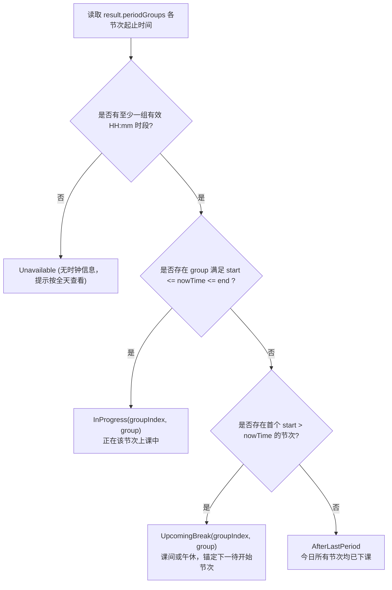
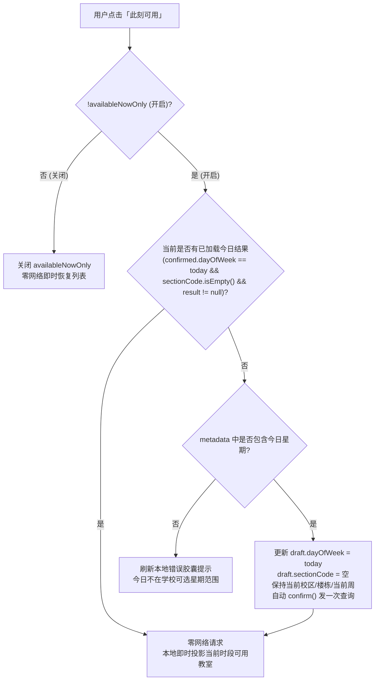

# 功能二工程设计：空教室快捷筛选与常用教学楼置顶

> 状态：已实施并完成单元测试与 UI 回归验证。文档内架构契约与实际源码实现保持一致。

**目标：** 显著缩短学生临时找自习教室时的操作路径：把原来每次打开都需要逐一重选"校区 → 教学楼 → 周次 → 星期 → 节次 → 查询 → 人工扫描空闲格"的 7 步流程，压缩为「一键直达常用教学楼」「此刻可用」「连续空 2 节以上」三大高频快捷能力，且不增加教务服务器请求压力。

**模块覆盖：** `core:model`、`core:domain`、`data`（仅设置与备份 DTO 扩展）、`feature:main`（**不修改**网络协议、学校 HTML 解析与 Room 数据库 Schema）。

---

## 1. 现状核查与痛点分析

### 1.1 现有实现基线

| 文件 | 现状机制 | 存在的操作与架构痛点 |
| --- | --- | --- |
| `core/model/.../Classroom.kt` | 定义 `ClassroomQuery`、`ClassroomBuilding(code, name)`、`ClassroomPeriodGroup(rawCode, label, startTime, endTime, sourceStartTime, sourceEndTime)`、`ClassroomCell(dayOfWeek, groupIndex, state)`、`ClassroomRoom`、`ClassroomResult` | 查询协议一次返回指定条件下各教室的全天及全周状态格与 `periodGroups` 时钟区间，具备本地二次筛选所需的完整数据底座 |
| `data/.../repository/RoomClassroomRepository.kt` | 按 `"$connectionId\|$campusCode"` 缓存教学楼字典 10 分钟；单次 `query` 携带 `allSectionCodes` 拉回整张占用矩阵 | 后端已回传全天所有节次占用状态，但当前 UI 未利用时段钟点或连续格做本地即时过滤，每次想筛时段都要手动改条件重新走网络请求 |
| `feature/main/.../classroom/ClassroomViewModel.kt` | 仅注入 `SchoolAuthPort` 与 `ClassroomRepositoryPort`；区分 `draft` 与 `confirmed` 防止脏状态；`dayDefault()` 直接调用 `LocalDate.now()` | 1. 缺 `Clock` 注入，不便控制时间单测；2. 每次进页需在校区加载后再从长列表中寻找常去的教学楼；3. 缺少「此刻可用」与「连续空 2 节以上」本地过滤与排序 |
| `feature/main/.../classroom/ClassroomQueryScreen.kt` | `FilterCard` 仅当 `draft.campusCode.isNotEmpty()` 才展示教学楼；`RoomCard` 依次平铺所有节次胶囊 | 大楼栋或全部教学楼查询结果常返回数十间教室，用户需逐张卡片肉眼对比当前时间及后续连续空闲情况 |

### 1.2 核心优化思路

1. **零额外网络开销优先**：当查询结果 `result` 已经覆盖当日全节次时，「连续空 2 节以上」与同日内切换「此刻可用」全部在纯 JVM 领域层完成本地计算与重排。
2. **仅跨日时自动同步查询**：当当前页面停留在其他星期或尚未查询，用户开启「此刻可用」时，自动把查询星期与周次同步到今日（若在 metadata 范围内），清除单节次过滤并立即触发查询。
3. **常用教学楼跨会话持久化**：把置顶楼栋写入 `AppPreferences` 并接入设置备份，无论下次冷启动还是重置重连，置顶快捷入口始终停留在筛选卡最上方。

---

## 2. 纯领域规则与筛选算法 (`core:domain`)

所有过滤、时段锚定、连空段识别与排序逻辑均放在 `core:domain` 的 `ClassroomQuickFilterEngine`（纯 Kotlin + 注入 `java.time.Clock`），禁止在规则内部直接调用系统静态 `LocalTime.now()`。

### 2.1 「此刻可用」(`availableNowOnly`) 时段解析规则

教务系统返回的 `periodGroups` 已按节次顺序排列（例如：`0102` `08:20-09:55`、`0304` `10:15-11:50`、`0506` `14:00-15:35`、`0708` `15:55-17:30`、`0910` `18:30-20:05`、`1112` 第十一节 `20:10-20:55`）。

给定当前本地时钟 `nowTime = LocalTime.now(clock)`，时段锚定函数 `resolveActivePeriodSlot(periodGroups, nowTime)` 按下述优先级判定目标槽位：



补充细则：

1. **时间字段回退顺序**：优先解析 `group.startTime` 与 `group.endTime`；若某节次被校正后为空，回退到 `group.sourceStartTime` 与 `group.sourceEndTime`；采用 `CourseValidator.isTimeValid` 或严谨 `HH:mm` 解析为当日分钟数 `0..1439`。
2. **边界闭合策略**：
   - 上课判定区间取闭区间 `[startMinutes, endMinutes]`（恰在整点打铃时刻命中本节）。
   - 课间休息（如 09:56 至 10:14）或早间未开课（如 07:50）时，命中 `UpcomingBreak`，即检查该即将开始的节次组是否为空闲（`FREE`），最符合学生找教室提前入座自习的真实需求。
   - 若已过当天最后一节 `endMinutes`（`AfterLastPeriod`），则当日没有剩余节次可筛，界面明确展示「今日课程已结束」，不误判或错误回退到明天第一节。
3. **可用状态严格度**：仅 `cell.state == ClassroomCellState.FREE` 视作可用；`COURSE`、`BORROWED`、`UNKNOWN`、`NOT_QUERIED` 均不计入可用，防止误把未知格或借用教室推荐给学生。

### 2.2 「连续空 2 节以上」(`minConsecutiveFreeGroups >= 2`) 连续段算法

**节次粒度说明：** 学校教室接口中一个 `ClassroomPeriodGroup` 通常对应 1 大节（2 小节连堂，如第 1–2 节），而 `1112`（`EleventhSection`）表示第十一节（1 小节）。因此「连续空 2 节以上」按 `result.periodGroups` 列表连续下标上的连续 `FREE` 节次组数量 $\ge 2$ 判定（保证实际可用连续时长通常在 135 至 190 分钟以上）。

1. **基础数据结构**：
   - 给定 `room: ClassroomRoom`、`dayOfWeek: Int` 与 `periodGroups: List<ClassroomPeriodGroup>`，按索引 `i in periodGroups.indices` 扫描每个单元格：
   - 记录所有极长连续 `FREE` 区间 `FreeRun(startIndex, endIndex)`，其长度 `length = endIndex - startIndex + 1`，连续结束时间 `endTime = resolvedEndTime(periodGroups[endIndex])`。
2. **双开关组合语义矩阵**：

| `availableNowOnly` | `minConsecutiveFreeGroups >= 2` | 匹配条件 | 卡片状态徽章展示示例 |
| --- | --- | --- | --- |
| `false` | `false` | 保留全部教室（原有行为） | 无附加徽章 |
| `true` | `false` | 锚定节次 `targetIndex` 状态为 `FREE`；计算从 `targetIndex` 向后最多可连续空闲几组 `k` | `空至 11:50`（若后续继续空闲则显示连续最终结束时刻） |
| `false` | `true` | 若未限定单节次 `sectionCode`：当天存在任意 `FreeRun.length >= 2`；若已限定某单节次 `selectedIndex`：必须从 `selectedIndex` 向后连续空闲 $\ge 2$ 组（跨度覆盖选定起点） | `连空 3 节`（取全天最长连空值，有明确时段时补最宽可用结束时间） |
| `true` | `true` | 必须从锚定节次 `targetIndex` 起向后连续 `FREE` 节次组数 $\ge 2$ | `此刻起连空 2 节` 与下一行 `空至 17:30`（分行无圆点） |

3. **结果稳定排序策略**：
   - 当任一快捷筛选生效时，对通过过滤的教室按以下权重排序：
     1. 有效连续空闲节数降序（从锚定槽位起算，未开启此刻可用时按全天最长 `FreeRun` 降序）；
     2. 剩余可用结束时间晚者优先（若结束时间一致则按教室名称数字自然序升序，如 `A101` 先于 `A102`、`A1001` 排在 `A203` 后按数字比较）。
   - 关闭全部快捷筛选时，恢复服务器原始 `result.rooms` 排序，零破坏既有展示顺序。

---

## 3. 「常用教学楼置顶」数据模型与持久化

### 3.1 模型扩展 (`core/model/.../Settings.kt`)

由于同一个学校存在多校区，教学楼代码在不同校区或将来扩展中建议与校区配对标识，以实现「一键直达指定校区+楼栋」。在 `core/model/.../Settings.kt` 新增设计契约：

```kotlin
package com.gfs.iyango.core.model

/** 已置顶的常用教学楼项。 */
data class PinnedClassroomBuilding(
    val campusCode: String = "",
    val campusName: String = "",
    val buildingCode: String = "",
    val buildingName: String = "",
) {
    /** 跨校区唯一复合键。 */
    val key: String get() = "$campusCode|$buildingCode"
}
```

在 `AppPreferences` 中追加字段及 `sanitized()` 规范化规则：

```kotlin
// 在 AppPreferences 中追加：
val pinnedClassroomBuildings: List<PinnedClassroomBuilding> = emptyList()

// 在 AppPreferences.sanitized() 中规范化：
pinnedClassroomBuildings = pinnedClassroomBuildings
    .map {
        it.copy(
            campusCode = it.campusCode.trim(),
            campusName = it.campusName.trim(),
            buildingCode = it.buildingCode.trim(),
            buildingName = it.buildingName.trim(),
        )
    }
    .filter { it.campusCode.isNotEmpty() && it.buildingCode.isNotEmpty() }
    .distinctBy { it.key }
    .take(MAX_PINNED_BUILDINGS) // 上限 8 项
```

### 3.2 持久化与备份兼容

1. **`data/.../repository/DataStoreAppSettings.kt`**：
   - 在内部 `AppPreferencesDto` 中新增 `PinnedBuildingDto` 列表字段：`val pinnedClassroomBuildings: List<PinnedBuildingDto> = emptyList()`。
   - 依赖既有的 `Json { ignoreUnknownKeys = true; encodeDefaults = true }`，旧版本应用升级读取缺少该键的 DataStore 时平稳回退空列表。
2. **`data/.../repository/DefaultSettingsBackup.kt`**：
   - 在 `PreferencesDto` 中同步纳入 `pinnedClassroomBuildings`，随用户设置导出/恢复跨机迁移；使用 `DefaultSettingsBackup` 的旧版本备份 JSON 恢复时缺省回退默认值（在 `applyTo(current)` 中若新旧备份未显式携带则保留默认值或空列表安全回退）。

---

## 4. `core:domain` 契约草图与双触点排序规则

建议新增 `core/domain/src/main/kotlin/com/gfs/iyango/core/domain/ClassroomQuickFilters.kt`（接口与数据契约草图，尚未落盘）：

```kotlin
package com.gfs.iyango.core.domain

import com.gfs.iyango.core.model.ClassroomBuilding
import com.gfs.iyango.core.model.ClassroomResult
import com.gfs.iyango.core.model.ClassroomRoom
import com.gfs.iyango.core.model.PinnedClassroomBuilding
import java.time.LocalTime

data class ClassroomQuickFilter(
    val availableNowOnly: Boolean = false,
    val minConsecutiveFreeGroups: Int = 1, // 1=关闭，2=至少连续空 2 节
) {
    val active: Boolean get() = availableNowOnly || minConsecutiveFreeGroups >= 2
}

sealed interface ActiveSlotResolution {
    data class InProgress(val groupIndex: Int, val label: String, val endTime: String) : ActiveSlotResolution
    data class UpcomingBreak(val groupIndex: Int, val label: String, val startTime: String) : ActiveSlotResolution
    data object AfterLastPeriod : ActiveSlotResolution
    data object Unavailable : ActiveSlotResolution
}

data class ClassroomRoomProjection(
    val room: ClassroomRoom,
    val highlightedGroupIndex: Int? = null,
    val consecutiveFreeCount: Int = 0,
    val freeUntilTime: String = "",
    val badgeText: String = "",
)

data class ClassroomFilterOutput(
    val rooms: List<ClassroomRoomProjection>,
    val activeSlot: ActiveSlotResolution? = null,
    val emptyReason: String = "",
)

object ClassroomQuickFilterEngine {
    fun resolveActiveSlot(
        result: ClassroomResult,
        nowTime: LocalTime,
    ): ActiveSlotResolution

    fun project(
        result: ClassroomResult,
        filter: ClassroomQuickFilter,
        nowTime: LocalTime,
    ): ClassroomFilterOutput

    /** 将教学楼选项按「当前校区已置顶优先 → 原顺序」重排。 */
    fun orderBuildingsWithPins(
        campusCode: String,
        buildings: List<ClassroomBuilding>,
        pinned: List<PinnedClassroomBuilding>,
    ): List<OrderedBuilding>
}

data class OrderedBuilding(
    val building: ClassroomBuilding,
    val isPinned: Boolean,
)
```

---

## 5. `ClassroomViewModel` 状态流与联动设计

### 5.1 构造依赖扩展与时钟注入

将 `feature/main/.../classroom/ClassroomViewModel.kt` 构造函数扩展为：

```kotlin
class ClassroomViewModel @Inject constructor(
    private val auth: SchoolAuthPort,
    private val repository: ClassroomRepositoryPort,
    private val appSettings: AppSettingsPort,
    private val clock: Clock,
) : ViewModel()
```

- 将原有第 663 行的 `LocalDate.now().dayOfWeek.value` 替换为 `LocalDate.now(clock).dayOfWeek.value`，消除非确定性全局时钟依赖。
- 持续收集 `appSettings.appPreferences` 中的 `pinnedClassroomBuildings` 与内部可变流 `_quickFilter`、原始 `_baseResult` 进行响应式合流（`combine`），每次变更即时重算 `filteredRooms`、`activeSlotResolution` 与 `orderedBuildings`。

### 5.2 核心状态与联动状态机



### 5.3 常用教学楼交互逻辑

1. **置顶 / 取消置顶切换**：
   - `togglePinCurrentBuilding()` 或 `togglePinBuilding(campusCode, buildingCode, buildingName)`：调用 `appSettings.transformAppPreferences { prefs -> ... }` 原子追加或移除对应 `PinnedClassroomBuilding`；若当前处于校区全部教学楼视图，立即触发 `orderedBuildings` 重排，并把刚置顶的教学楼同步前置到顶部「常用」区。
   - 若置顶列表已达 8 项上限，点击新置顶时给出轻量反馈或按策略拦截，避免无限膨胀。
2. **点击常用教学楼一键切换**：
   - `selectPinnedBuilding(pin: PinnedClassroomBuilding)`：
     1. 校验 `metadata.campuses` 中是否存在 `pin.campusCode`（不存在说明教务下线该校区或置顶失效，弹出失效提示并提供一键移除）。
     2. 同步将 `draft` 更新为 `campusCode = pin.campusCode` 与 `buildingCode = pin.buildingCode`。
     3. 加载该校区教学楼列表并在就绪后校验 `pin.buildingCode` 仍有效；若已切换完成且满足 `queryProblem == null`，自动调用 `confirm()` 触发查询（把原先「点校区 → 等待加载 → 找教学楼 → 点查询」4 步操作合一）。
3. **教学楼加载并发守卫继承**：
   - 若在点击常用楼切换后、教学楼尚未返回前用户又手动换了校区，沿用现有 `buildingGeneration` 代次淘汰机制丢弃旧结果，不覆盖新草稿。

---

## 6. UI 极简布局规范 (`ClassroomQueryScreen`)

严格执行项目 `AGENTS.md` 中的**「砍掉冗余文字」「布局优先于解释」「禁止圆点分隔」**三项铁律：

### 6.1 筛选条件卡片 (`FilterCard`)

1. **常用教学楼置顶条**（仅当 `state.pinnedBuildings.isNotEmpty()` 时展示，无常用楼时不占位、不展示“暂无常用楼，请添加”空提示）：
   - 标题标签：`常用教学楼`
   - 横向滑动胶囊条：每个胶囊显示 `buildingName`（当存在同名跨校区楼栋时在第二行或后缀以空格补上 `campusName`，**不用圆点分隔**），选中态高亮显示，点击一键直达；胶囊右侧小图标提供直接取消置顶入口，或通过当前楼栋旁的固定图标切换，**零文字操作说明书**。
2. **教学楼行改造**（当 `draft.campusCode.isNotEmpty()` 且列表就绪）：
   - 选项列表按 `全部教学楼` → 本校区已置顶教学楼（图标前缀或选中区标识 `PushPin` 实心图标）→ 其余教学楼排列。
   - 当 `draft.buildingCode.isNotEmpty()`（选中具体某一教学楼）时，在「教学楼」标签行右侧放置一个紧凑图标按钮（实心/空心图钉 `Icons.Filled.PushPin` / `Icons.Outlined.PushPin`，无障碍 `contentDescription = if (pinned) "取消置顶" else "置顶常用"`），点击即完成置顶或取消，图标语义自解释。
3. **快捷筛选开关栏**（位于 `ResultHeader` 下方或紧贴结果列表顶部，`LazyColumn` 粘性或固定头部区域，确保切换无需重新滑回 `FilterCard`）：
   - 两枚并排 `LiquidFilterChip`：
     - `此刻可用`
     - `连续空 2 节以上`
   - 若当前为「此刻可用」激活状态，在芯片下方（或 `ResultHeader` 次行）直接以简洁数值徽标展示锚定基准，例如：
     - `当前时段 第3-4节 10:15-11:50`（正在上课）
     - `下一时段 第5-6节 14:00-15:35`（课间/午休）
     - 严禁加入"系统已根据当前手机时间自动为您匹配…"之类解释性废话。

### 6.2 教室结果卡片 (`RoomCard`) 布局升级

- 顶部标题行左侧显示 `room.name`，右侧紧邻简洁可用状态胶囊（仅当快捷筛选激活且有明确结果时显示）：
  - 若开启「连续空 2 节以上」或「此刻可用」：`连空 3 节`、`空至 17:30`。
  - 教室名称、类型、编号、座位数之间保持空格或换行，**严禁引入圆点符号**。
- 节次网格区域中，被「此刻可用」锚定的 `highlightedGroupIndex` 格对应标签增加轻微高亮描边（跟随品牌强调色 `brand.accent`），一眼锁定当前时间段状态；同时保持点击「上课」「借用」弹出 `DetailSheet` 详情弹窗的交互不变。

---

## 7. 边界条件与异常降级

| 边界场景 | 处理策略 |
| --- | --- |
| 下课后或夜间（超过当天所有 `periodGroups` 结束时间，例如 21:30）开启「此刻可用」 | `resolveActiveSlot` 返回 `AfterLastPeriod`，保留筛选芯片可开关状态，结果区展示 `今日课程已结束`，点击关闭芯片立即恢复全天矩阵 |
| 用户已手动在草稿中选了非今日星期（例如周六），此时点击「此刻可用」 | 自动把 `draft.dayOfWeek` 同步设为今日星期、`draft.sectionCode` 清空后重新拉取今日课表；关闭「此刻可用」时不强行改回旧星期 |
| 学校接口返回缺少 `startTime` 与 `sourceStartTime` 时钟 | `resolveActivePeriodSlot` 返回 `Unavailable`，自动关闭「此刻可用」效果或提示该时段缺少时钟信息，绝不发生时间解析崩溃 |
| 某些教室某节次处于 `UNKNOWN` 或 `NOT_QUERIED` | 连空算法仅将明确为 `FREE` 的格记作空闲，遇到 `UNKNOWN`/`COURSE`/`BORROWED` 即截断连续段 |
| `第十一节`（`rawCode = "1112"`, `20:10-20:55`）连空统计 | 在 `periodGroups` 连续索引上仍按一个独立槽位参与连续检测；若第 9-10 节与第 11 节均为空闲，连续组数 = 2，合并空档结束时间精确显示 `20:55` |
| 跨学期或教务重命名后，某已置顶 `PinnedClassroomBuilding` 从远端消失 | 检测到远端列表中不存在该 `campusCode` 或 `buildingCode` 时，不发出无效请求，直接给出明确错误提示并提供一键从常用列表移除 |

---

## 8. 测试矩阵与验收标准

### 8.1 测试设计清单

| 模块 | 建议测试文件 | 核心覆盖断言 |
| --- | --- | --- |
| `core:model` | `AppPreferencesSanitizeTest.kt` | `pinnedClassroomBuildings` 去重、去空字段、截断至最多 8 项边界校验 |
| `core:domain` | `ClassroomQuickFilterEngineTest.kt` | 上课边界时刻（等于 `startTime`/`endTime`）、课间锚定下一节、超过末节返回 `AfterLastPeriod`、时钟缺失降级、`NOT_QUERIED`/`UNKNOWN` 截断连空段、第 11 节合并结束时刻、按连续长度降序排序、置顶教学楼列表置顶重排与多校区不混淆 |
| `data` | `DisplayPreferencesPersistenceTest.kt` / `SettingsBackupMotionPreviewTest.kt` | `AppPreferences` 含 `pinnedClassroomBuildings` 写入 DataStore 往返一致；旧备份 JSON 缺省该键恢复后不崩溃且保留默认值 |
| `feature:main` | `ClassroomViewModelQuickFilterTest.kt` | 固定 `Clock` 测试：同日开「此刻可用」零额外 `repository.query` 调用；跨日开「此刻可用」自动对齐今日星期并清除 `sectionCode` 发一次查询；点击常用教学楼并发代次丢弃与自动查询；退出登录或切换账号后查询状态隔离 |
| `feature:main` | `ClassroomQueryScreenUiTest.kt`（Robolectric） | 有置顶时显示「常用教学楼」行、无置顶时不显示；图钉点击切换状态；卡片正确呈现「连空 N 节」「空至 HH:mm」且文案无圆点分隔符；既有的占用详情弹窗点击正常打开 |

### 8.2 功能验收标准（Definition of Done）

- [ ] 开启「此刻可用」后，正在上课与课间休息两类真实场景都能精准匹配到对应节次或下一即将开始节次，末节课结束之后正确给出提示态。
- [ ] 开启「连续空 2 节以上」时，仅保留至少有 2 个连续空闲时段组的教室，并按连续空闲更久的教室排在前面，且同时保留原有点击占用节次查看课程详情闭环。
- [ ] 常用教学楼置顶/取消置顶写入 DataStore，杀死进程重启及设置备份恢复后均正常保留；在筛选区点击任意常用楼可一键切定位到目标楼栋并加载结果。
- [ ] 界面全程遵循极简准则，无说明性冗余标语，无任何圆点分隔字符。
