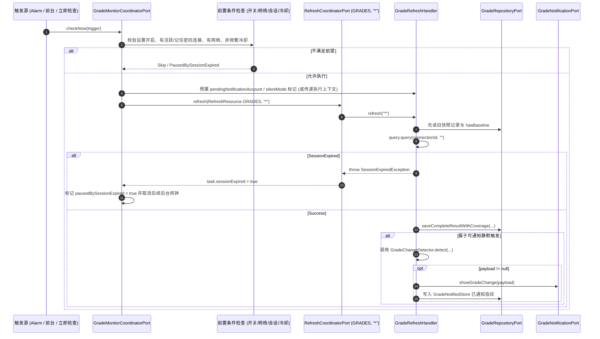

# 功能三工程设计：新出分变动通知与绩点变化摘要

> 状态：已实施并完成单元测试与 Robolectric 集成验证。文档内架构契约与实际源码实现保持一致。

**目标：** 在用户开启通知能力后，当教务系统发布新成绩或更正既有成绩时，于前台静默检查或后台低频唤醒检查阶段精准捕捉增量变更，计算本学期绩点（GPA）变动幅度并推送结构简洁的 Android 系统通知；点击通知直达应用「成绩」页签（Tab 2）。同时守住首次登录不刷屏、遇会话失效立即退避防教务风控、锁屏隐私脱敏及多账号严格隔离四条底线。

**模块覆盖：** `core:model`、`core:domain`、`data`、`platform:android`、`feature:main`、`app`（**不修改** Room 数据库 Schema，保持 `version = 7`）。

---

## 1. 现状核查与关键陷阱识别

### 1.1 现有基线模块

| 组件 / 文件 | 现有机制 | 与本功能关系 |
| --- | --- | --- |
| `data/.../repository/RoomGradeRepository.kt` | 在单事务 `saveCompleteResultWithCoverage` 中对比旧快照与新记录，设置 `isNew` 与 `isModified` | 提供「首次无基线不标新」原则，但**不能直接靠落库后的 `isNew` 弹通知**（见下文陷阱 1） |
| `data/.../repository/GradeRefreshHandler.kt` | 注册到 `RefreshHandlerRegistry`，执行 `RefreshResource.GRADES`（`queryFingerprint` 为学期值或 `*` 全部学期），支持记住密码自动续登 | 是成绩网络拉取与落库的唯一权威入口，避免多处重复请求教务端口 |
| `data/.../repository/AppRefreshCoordinator.kt` | 维护 `RefreshResource` 单飞并发锁、超时与前台冷却控制；当前 `AUTO_REFRESH_RESOURCES` 仅含课表、资料、考试 | 所有前台、后台静默检查一律复用协调器走 `RefreshResource.GRADES`，杜绝并发写覆盖 |
| `core/domain/.../GradeStatistics.kt` | `GradeStatisticsCalculator.calculate(records, includeOptional = false)` 统一加权均分、平均绩点、五级制折算与公选课排除口径 | 通知里的 GPA 差值必须与成绩页默认统计保持 100% 同口径 |
| `app/.../IYangoApplication.kt` | `onAppEnteredForeground()` 仅在进程真正由后台切回前台（非配置重建）时触发 | 前台静默检查成绩与评估后台排程的理想宿主机钩子 |
| `platform/android/.../ScheduleWidgets.kt` & `MainActivity.kt` | `LaunchIntents.TAB_ROUTES = listOf("today", "schedule", "grades", "mine")`，支持 `LaunchIntents.launchIntent(context, tab = 2)` 直达成绩页签 | 通知点击 `PendingIntent` 直接复用 `LaunchIntents`，遵循白名单导航校验 |

### 1.2 核查代码发现的关键架构陷阱

1. **陷阱一：绝对不能直接查询落库后的 `isNew` / `isModified` 来触发系统通知**
   - `RoomGradeRepository.saveCompleteResultWithCoverage` 第 156 至 157 行写法如下：
     `isNew = !firstBaseline && (old == null || old.isNew)`
   - 在用户进入成绩页触发 `markChangesRead` 之前，哪怕连续刷新 5 次，`isNew` 都会持续为 `true`。若直接读取 `isNew` 弹窗，每次后台唤醒都会**反复轰炸同一门课的出分通知**。
   - **正解**：必须在 `GradeRefreshHandler` 保存新结果**之前**读取当前旧快照记录作为对比基准，再与刚拉回的新记录在 `GradeChangeDetector` 内作当轮严格增量对比，并通过持久化的 `GradeNotifiedStore` 核对去重指纹集合。
2. **陷阱二：`ALL_SEMESTERS`（`"*"`）分区下数据库行直接携带 `semester = "*"`**
   - 核查 `RoomGradeRepository.toDomainModel()`（第 200 至 209 行）可见：在全学期分区写入数据库的记录，实体列的 `semester` 存为 `"*"`，真实学期需要从 `schoolRecordId`（格式 `ygu:<realSemester>|...`）还原解析。
   - 若直接按原始实体 `semester` 分组算本学期 GPA 会得到错误结果；对比旧记录与新记录前，**必须使用已解析真实学期的领域 `GradeRecord`**（通过 `GradeRepositoryPort.observeRecords` 或等价规范化读取接口获取）。
3. **陷阱三：成绩页主动下拉刷新不得弹出系统通知**
   - 当用户本人正打开「成绩」页手动点刷新时，页内已经能实时看见红点与新增卡片，此时若顶部再弹出系统通知属于冗余干扰。必须区分「用户成绩页主动刷新」与「后台 / 前台静默检查」。

---

## 2. 增量检测与 GPA 差值算法 (`GradeChangeDetector`, `core:domain`)

纯 JVM 模块 `core:domain` 负责判定「哪些成绩算新增/变更」以及「受影响最新学期的 GPA 前后差值」。

### 2.1 输入输出契约（设计草图）

建议新增 `core/domain/src/main/kotlin/com/gfs/iyango/core/domain/GradeChangeDetector.kt`：

```kotlin
package com.gfs.iyango.core.domain

import com.gfs.iyango.core.model.GradeRecord

enum class GradeChangeKind {
    NEWLY_PUBLISHED,
    SCORE_UPDATED,
}

data class GradeChangeItem(
    val record: GradeRecord,
    val kind: GradeChangeKind,
    val previousScoreText: String = "",
    val dedupeKey: String,
)

data class GradeGpaDeltaSummary(
    val semester: String,
    val beforeTermGpa: Double?,
    val afterTermGpa: Double?,
    val deltaTermGpa: Double?,
    val afterCumulativeGpa: Double?,
)

data class GradeChangeNotificationPayload(
    val accountKey: String,
    val partition: String,
    val items: List<GradeChangeItem>,
    val gpaSummary: GradeGpaDeltaSummary?,
    val summaryTitle: String,
    val expandedLines: List<String>,
    val publicLockscreenText: String,
    val dedupeKeys: Set<String>,
)

object GradeChangeDetector {
    fun detect(
        accountKey: String,
        partition: String,
        hadBaseline: Boolean,
        previousRecords: List<GradeRecord>,
        newRecords: List<GradeRecord>,
        alreadyNotifiedKeys: Set<String>,
        includeOptional: Boolean = false,
    ): GradeChangeNotificationPayload?
}
```

### 2.2 增量判定与去重规则

1. **首次基线绝对静默**：
   - `hadBaseline == false`（该账号在当前分区此前从未建立成功缓存快照）时，函数直接返回 `null`。确保新用户第一次登录、清除缓存后首次同步或切换新账号时**零通知刷屏**。
2. **当轮新出分 / 更正筛选条件**：
   - 建立旧记录索引 `previousByKey = previousRecords.associateBy { it.stableKey }`。
   - 对每条归一化 `record in newRecords`：
     - 定义当前分值文本 `newScore = record.scoreText.trim()`；若 `newScore.isEmpty()`（教务存在未录入分数的占位行），跳过不记为已出分。
     - 定义去重指纹 `dedupeKey = "${record.stableKey}|$newScore"`；若 `dedupeKey in alreadyNotifiedKeys`，跳过。
     - 查找 `old = previousByKey[record.stableKey]`：
       - 若 `old == null` 或 `old.scoreText.trim().isEmpty()`：标记为 `GradeChangeKind.NEWLY_PUBLISHED`。
       - 若 `old.scoreText.trim().isNotEmpty() && old.scoreText.trim() != newScore`：标记为 `GradeChangeKind.SCORE_UPDATED`（记录 `previousScoreText`）。
       - 其余无变动记录忽略。
   - 若没有任何变更条目，返回 `null`。
3. **跨学期还原与 GPA 差值计算**：
   - 若某条记录的 `record.semester` 仍为 `GradeRepositoryPort.ALL_SEMESTERS`（`"*"`），按 `schoolRecordId` 前缀 `ygu:<realSemester>|` 兜底提取真实学期。
   - 从本次发生变更的 `items` 中，挑选按自然字符串降序排列的最新有效学期作为 `affectedSemester`（例如 `"2026-2027-1"`；若单学期刷新则直接取当前分区学期）。
   - 计算基准前后的**本学期平均绩点**（严格调用既有 `GradeStatisticsCalculator.calculate(..., includeOptional = includeOptional)`）：
     - `beforeStats = calculate(previousRecords.filter { resolvedSemester(it) == affectedSemester }, includeOptional)`
     - `afterStats = calculate(newRecords.filter { resolvedSemester(it) == affectedSemester }, includeOptional)`
     - 当 `beforeStats.averageGradePoint != null && afterStats.averageGradePoint != null` 时，`deltaTermGpa = afterTermGpa - beforeTermGpa`。
     - 若本次刷新分区为 `ALL_SEMESTERS`（`"*"`），额外计算全学期总计 `afterCumulativeGpa = calculate(newRecords, includeOptional).averageGradePoint`。
   - **纯等级 / 无绩点课程边界**：若新出的仅有免修/合格等不计学分或无法解析绩点的课程导致 `afterTermGpa == null`，`gpaSummary` 允许绩点字段为空，通知仅展示新出分数目与课程名，不虚构 `0.00` GPA。

### 2.3 通知文案规范（遵循 `AGENTS.md` 无圆点要求）

所有通知正文中禁止使用中圆点分隔，改用空格与换行分层：

| 场景 | 通知标题 (`summaryTitle`) | 展开正文 (`BigTextStyle`, 每项独立一行) |
| --- | --- | --- |
| 单门新出分（有 GPA 变化） | `新增 1 门成绩` | 第一行：`高等数学(上) 92`<br/>第二行：`2026-2027-1 学期绩点 3.74 (+0.08)` |
| 单门分数更正 | `成绩变动通知` | 第一行：`大学物理 84 → 88`<br/>第二行：`2026-2027-1 学期绩点 3.76 (+0.02)` |
| 多门同时出分（例如 3 门） | `新增 3 门成绩` | 第 1 至最多 4 行：逐行 `<课程名> <分数>`（如 `操作系统 90`）<br/>若超过 4 门追加：`等共 N 门课程`<br/>末行汇总（若有变化）：`本学期绩点 3.81 (+0.06) 总绩点 3.74` |
| 锁屏隐私替身 (`publicVersion`) | `iYango 成绩更新` | `有新的成绩发布，解锁查看详情`（不暴露课程名、分数与绩点） |

---

## 3. 触发渠道、后台调度与教务风控防护

### 3.1 三类刷新触发来源隔离 (`GradeCheckTrigger`)

为了防止手动刷新弹出冗余通知，同时保证静默同步有序单飞，在 `core:domain` 定义触发来源：

```kotlin
enum class GradeCheckTrigger {
    /** 用户主动在成绩页内触发的查询/下拉刷新：仅更新本地缓存与未读红点，不弹系统通知。 */
    USER_MANUAL_IN_GRADES_PAGE,
    /** 应用从后台进入前台时的静默检查（受冷却期与网络状态约束）。 */
    FOREGROUND_SILENT,
    /** 系统定时闹钟唤醒的后台静默检查（周期可配，受省电与会话状态保护）。 */
    BACKGROUND_PERIODIC,
    /** 用户在通知设置页主动点击「立即检查」。 */
    MANUAL_CHECK_IN_SETTINGS,
}
```

### 3.2 后台定时方案选型：`AlarmManager` 非精确唤醒 vs `WorkManager`

| 维度 | 方案 A（推荐）：`AlarmManager` 非精确周期唤醒 | 方案 B：引入 AndroidX `WorkManager` + `hilt-work` |
| --- | --- | --- |
| 依赖与构造成本 | **零新增依赖**，完全复用现有 `libs.versions.toml` 与 `platform:android` receiver 模式（已有 `ReminderReceiver`、`SystemEventReceiver`） | 需新增 `work-runtime-ktx` 与 `hilt-work`，并对接 `IYangoApplication` 自定义 `Configuration.Provider` |
| 耗电与权限约束 | 使用 `AlarmManager.setAndAllowWhileIdle(RTC_WAKEUP, ...)`，**不申请 `SCHEDULE_EXACT_ALARM`**，系统自动对齐 Doze 维护窗口或批次唤醒，符合低频率成绩轮询省电要求 | 原生支持 `NetworkType.CONNECTED` 约束与指数退避，持久化跨重启调度队列 |
| 可替换性 | 调度与执行全部收敛在 `DefaultGradeMonitorCoordinator` + `GradeNotificationPort` 背后；未来若需升级 WorkManager，**domain 与 UI 零改动** | 同上 |
| 结论 | **本期采用方案 A**（非精确闹钟 + `GradeCheckReceiver` 内部校验网络/条件），保持依赖干净与可控 | 作为未来扩展兼容备选 |

### 3.3 后台检查状态流与防教务风控守则



必须落地的 5 条风控与省电护栏：

1. **会话失效立即熔断暂停后台闹钟**：
   - 若教务系统长期未登录导致 Cookie 过期且自动续登失败（返回 `SessionExpiredException`），`GradeMonitorCoordinator` **立即把内部状态设为 `pausedBySessionExpired = true` 并取消后续 `AlarmManager` 定时任务**。绝不在每 2 至 4 小时反复撞击教务认证界面触发验证码拦截或账号锁定，直到用户回到 App 重新登录账号后自动恢复轮询。
2. **后台检查前置网络检查**：
   - `GradeCheckReceiver` 在唤醒后先检查系统网络能力是否具备 `NET_CAPABILITY_INTERNET` 且（API 23+ 上）具备有效可用状态；无网状态直接结束 `goAsync()` 并按原周期顺延下一次唤醒，避免白白起协程。
3. **前台冷却防抖与退避策略**：
   - `FOREGROUND_SILENT` 设置最小冷却间隔 `FOREGROUND_SILENT_COOLDOWN_MS = 30 * 60 * 1000L`（30 分钟），高频切回应用不连续打教务接口。
   - 若后台拉取遇普通网络/超时失败，保持原下一次周期间隔（至少 2 小时），不做短间隔重试风暴。
4. **严格并发去重**：
   - 前台成绩页刷新与后台静默检查共用同一个 `AppRefreshCoordinator` 里的 `(RefreshResource.GRADES, "*")` 键，确保不会并发双请求或后写覆盖前写。
   - `GradeRefreshHandler` 内通知检测逻辑与单次刷新上下文绑定（例如使用线程安全原子计数器或显式 `GradeRefreshMode` 队列，保证：只有由 `GradeMonitorCoordinator` 发起的那一轮才进入通知判定，`GradesViewModel` 发起的 `USER_MANUAL_IN_GRADES_PAGE` 绝不误弹系统通知）。
5. **多账号切换与退出清理**：
   - 每个 `accountKey` 的通知采用独立稳定 `notificationId = NOTIFICATION_ID_BASE + (accountKey.hashCode() and 0x0FFF)`。
   - `GradeNotifiedStore` 按 `accountKey` 分桶保存最近 200 条已通知 `dedupeKey`（FIFO 裁剪防止文件膨胀）。
   - 账号退出登录（`LOGGED_OUT`）或清除缓存时，取消对应账号系统通知、清理该账号通知指纹，并暂停/重评估后台周期调度。

---

## 4. 数据模型、领域端口与设置持久化

### 4.1 设置模型扩展 (`core/model/.../Settings.kt`)

在既有 `ReminderSettings` 中新增出分通知设置项（默认开启/关闭可控，**默认建议 `gradeNotifyEnabled = false` 显式授权启用**，确保老版本升级无突兀后台打扰；且随用户主动开启开关同时引导申请通知权限）：

```kotlin
// 在 ReminderSettings 中追加：
val gradeNotifyEnabled: Boolean = false,
/** 后台自动检查周期（小时）：支持 2 / 4 / 6 / 12。 */
val gradeCheckIntervalHours: Int = 4,
/** 锁屏界面隐藏课程名与具体分数。 */
val gradeNotifyHideScoreOnLockscreen: Boolean = true,
```

`ReminderSettings.sanitized()` 同步约束：

```kotlin
gradeCheckIntervalHours = when (gradeCheckIntervalHours) {
    2, 4, 6, 12 -> gradeCheckIntervalHours
    else -> 4
}
```

持久化与设置备份同步扩展：
- `data/.../repository/DataStoreAppSettings.kt` 的 `ReminderDto` 新增上述 3 字段及默认值。
- `data/.../repository/DefaultSettingsBackup.kt` 的 `ReminderDto` 导出/恢复上述 3 字段；旧版无此键的备份恢复时平滑回退默认值，兼容无损。

### 4.2 新增领域端口 (`core/domain/.../GradeNotificationPorts.kt`)

```kotlin
package com.gfs.iyango.core.domain

import kotlinx.coroutines.flow.StateFlow

enum class GradeCheckOutcome {
    IDLE,
    CHECKED_NO_CHANGES,
    NOTIFIED,
    SKIPPED_NO_ACCOUNT,
    SKIPPED_NO_NETWORK,
    SKIPPED_COOLDOWN,
    PAUSED_SESSION_EXPIRED,
    FAILED,
}

data class GradeMonitorStatus(
    val enabled: Boolean = false,
    val intervalHours: Int = 4,
    val hideScoreOnLockscreen: Boolean = true,
    val notificationsAllowed: Boolean = false,
    val hasAccount: Boolean = false,
    val sessionExpiredPaused: Boolean = false,
    val lastCheckAt: Long = 0L,
    val lastOutcome: GradeCheckOutcome = GradeCheckOutcome.IDLE,
    val lastNotifiedCount: Int = 0,
    val lastError: String = "",
)

interface GradeNotificationPort {
    fun notificationsAllowed(): Boolean
    fun showGradeChange(payload: GradeChangeNotificationPayload): Boolean
    fun cancelForAccount(accountKey: String)
    fun cancelAll()
}

interface GradeMonitorCoordinatorPort {
    val status: StateFlow<GradeMonitorStatus>
    suspend fun setEnabled(enabled: Boolean)
    suspend fun setIntervalHours(hours: Int)
    suspend fun setHideScoreOnLockscreen(hide: Boolean)
    /** 由 Application 前台回调、Alarm Receiver 或设置页手动触发评估。 */
    suspend fun checkOnTrigger(trigger: GradeCheckTrigger): GradeCheckOutcome
    /** 权限变化、登录/重连成功或系统事件（开机/包更新/时间变更）后重新对齐调度。 */
    suspend fun syncSchedule()
    /** 用户在成绩页内查阅或标为已读后，顺带收起通知栏中该账号残留的出分通知。 */
    suspend fun clearPostedNotification(accountKey: String)
}
```

### 4.3 `data` 与 `platform:android` 核心实现设计

1. **`data/.../repository/GradeNotifiedStore.kt`（本机小体积状态与指纹库）**：
   - 使用独立 DataStore（或私有 JSON 文件 + Mutex 串行保护，如 `"grade_notify_state"`），与个性化 `AppPreferences` 隔离，**不进入跨机设置备份**（避免 A 手机通知状态抑制 B 手机）。
   - 存储字段：`lastCheckAt`、`lastOutcome`、`lastError`、`pausedBySessionExpired`、`notifiedKeysByAccount: Map<String, List<String>>`（每账号上限 200 条 FIFO）。
2. **`data/.../repository/GradeRefreshHandler.kt`**：
   - 保持既有的单参 `refresh(queryFingerprint)` 执行流，但在读取远端前增加预检查：
     - 记录 `hadBaseline` 与旧快照归一化成绩列表 `previousRecords`。
     - 成功写库 `repository.saveCompleteResultWithCoverage(...)` 后，经内部协调回调接口（仅由 `DefaultGradeMonitorCoordinator` 在静默检查期间认领，成绩页主动刷新时不认领），把 `(accountKey, partition, hadBaseline, previousRecords, result.records)` 交给 `DefaultGradeMonitorCoordinator` 执行 `GradeChangeDetector.detect` 与发通知。
3. **`data/.../repository/DefaultGradeMonitorCoordinator.kt`**：
   - 管理前台/后台/立即检查三种触发条件校验（开关、账户、`RefreshCoordinatorPort`、`GradeCheckSchedulerPort` 或平台调度器回调）。
   - 前台检查冷却（30 分钟），后台周期检查由调度器按 `intervalHours * 3_600_000L` 调度；当 `schoolAuth.observeActiveConnection()` 检测到账号恢复 `ACTIVE` 后，自动清除 `pausedBySessionExpired` 并重建后台计划。
4. **`platform/android/.../AndroidGradeNotificationPlatform.kt` & `GradeCheckReceiver`**：
   - 通知渠道常量：`CHANNEL_ID = "grade_updates"`，名称 `"新出分通知"`，级别 `NotificationManager.IMPORTANCE_DEFAULT`。
   - 构造通知时设置：
     - `setContentTitle(payload.summaryTitle)`
     - `setContentText(payload.expandedLines.firstOrNull().orEmpty())`
     - `setStyle(NotificationCompat.BigTextStyle().bigText(payload.expandedLines.joinToString("\n")))`
     - `setAutoCancel(true)`
     - `setContentIntent(PendingIntent)`：指向 `LaunchIntents.launchIntent(context, tab = 2)`，flag 包含 `FLAG_UPDATE_CURRENT or FLAG_IMMUTABLE`。
     - 若设置 `hideScoreOnLockscreen == true`：构建脱敏 `publicNotification`（仅含 `publicLockscreenText`），通过 `setVisibility(NotificationCompat.VISIBILITY_PRIVATE)` + `setPublicVersion(publicNotification)` 防止他人在锁屏预览具体分数。
   - **闹钟调度与广播**：
     - `GradeCheckReceiver`（继承 `BroadcastReceiver` + `@AndroidEntryPoint`）接收内部显式广播，校验权限/开关后用 `goAsync()` 在 `CoroutineScope(SupervisorJob() + Dispatchers.IO)` 中调用 `coordinator.checkOnTrigger(GradeCheckTrigger.BACKGROUND_PERIODIC)`，并无论成功失败排入下一个周期或按需停表。
     - `SystemEventReceiver` 在 `BOOT_COMPLETED` / `MY_PACKAGE_REPLACED` / `TIME_CHANGED` / `TIMEZONE_CHANGED` 时同步调用 `gradeMonitorCoordinator.syncSchedule()`。

---

## 5. `app` 与 `feature:main` 集成与极简 UI

### 5.1 宿主配置 (`app`)

- **`app/.../di/AppBindings.kt`**：新增 `@Binds @Singleton` 绑定 `GradeNotificationPort → AndroidGradeNotificationPlatform` 与 `GradeMonitorCoordinatorPort → DefaultGradeMonitorCoordinator`（若拆出纯平台闹钟排程接口 `GradeCheckSchedulerPort`，同步集中在此绑定）。
- **`app/src/main/AndroidManifest.xml`**：注册 `<receiver android:name="com.gfs.iyango.platform.android.GradeCheckReceiver" android:exported="false" />`。
- **`app/.../IYangoApplication.kt`**：
  - 注入 `gradeMonitorCoordinator: GradeMonitorCoordinatorPort`。
  - 在 `onCreate()` 检查调度同步（非阻塞协程）；在 `onAppEnteredForeground()` 启动协程调用 `gradeMonitorCoordinator.checkOnTrigger(GradeCheckTrigger.FOREGROUND_SILENT)`（若开关关闭直接 $O(1)$ 返回，零网络开销）。

### 5.2 设置页与成绩页联动 (`feature:main`)

1. **`ReminderCalendarViewModel.kt` 与 `ReminderCalendarScreen.kt`**：
   - 在现有的「课程通知」「系统日历」两张卡片之后，新增 `SectionCard(title = "新出分通知")`，布局沿用现成极简风格，无长段说明标语、无圆点分隔：
     - `SettingSwitchRow(title = "新出分通知", checked = ..., onCheckedChange = ...)`；首次开启且通知未授权时自动触发既有 `requestNotificationPermission()`。
     - 展开子项（仅当开启时显示）：
       - 标题 `检查频率`，横向 `LiquidFilterChip` 行：`2 小时` / `4 小时` / `6 小时` / `12 小时`。
       - `SettingSwitchRow(title = "锁屏隐藏具体分数", ...)`。
       - 通知权限未授权时展示 `StatusRow("通知权限", "未授权", action = "去授权" to ...)`。
       - 状态摘要：`最近检查 <HH:mm>` 或 `账号登录失效 已暂停后台检查` 或 `尚无检查记录`（多条状态直接换行，不加圆点）。
       - 操作按钮：`LiquidOutlinedButton("立即检查")`（触发 `MANUAL_CHECK_IN_SETTINGS`，并通过 Snackbar 反馈「检查完成，暂未发现新成绩」或「发现 N 门新成绩」）。
2. **`GradesViewModel.kt`**：
   - 注入 `GradeMonitorCoordinatorPort`（或带空默认实现的引用以防破坏既有无参/少参测试构造兼容——若采用新增可选参数/默认值策略，**零破坏既有全部 `grades/*Test.kt` 用例**）。
   - 用户进入成绩页加载记录或触发 `markRead()` 时，调用 `gradeMonitorCoordinator.clearPostedNotification(accountKey)` 自动消除通知栏滞留的通知。

---

## 6. 边界条件与故障演练

| 边界场景 | 预期行为 |
| --- | --- |
| 新装首次绑定账号并全量同步出 42 门既往成绩 | `hadBaseline == false` 直接返回 `null`，不发送任何新出分通知 |
| 用户收到 1 条通知，点击直达成绩页，随后未点「全部已读」又退回后台再重连 | 因为 `GradeNotifiedStore` 已记入 `"stableKey\|scoreText"` 指纹且当轮无新增增量，绝不重复推送 |
| 某门课程老师先把分数撤回成空白，之后重新挂出一个不同或相同分数 | 空白行忽略不报错；挂出非空新分数若与已记录的最后发布分数不同（如 `82 -> 86`）记为 `SCORE_UPDATED` 并通知新值 |
| 退考 / 补考 / 重修出现两行同课程名不同 `schoolRecordId` 或不同 `examType` 的记录 | 依赖 `GradeRecord.stableKey`（含 `schoolRecordId` / `examType`）严格区分身份，不误判，且按 `GradeStatisticsCalculator` 原样参算 GPA |
| 用户已开启功能，但随后在系统设置里手动关闭 App 通知权限 | 下次触发检查前仍可本地记录变动（供进页标新），发通知调用受系统策略或权限检查拦截安全返回 `false`，设置页立即实时呈现 `通知权限 未授权` |
| 后台闹钟唤醒时教务密码改了导致持续登录失效 | 第 1 次遇到 `SessionExpiredException` 即停掉后续闹钟并标记 `pausedBySessionExpired`，绝不连续高频撞账号接口引发安全冻结 |
| 切换为同学的第二个教务账号登录 | `accountKey` 变化隔离各自基线、通知 ID 与已通知指纹，互不交叉提示 |

---

## 7. 测试矩阵与验收标准

### 7.1 模块化测试覆盖矩阵

注意模块构建约束（见 `platform/android/build.gradle.kts`）：`platform:android` 未依赖 `kotlinx-coroutines-test`，异步测试在 `runBlocking` 中执行，Robolectric 用例统一标记 `@Config(sdk = [35])`。

| 模块 | 建议测试文件 | 核心覆盖断言 |
| --- | --- | --- |
| `core:domain` | `GradeChangeDetectorTest.kt` | 首次基线无通知、单门出分、多门出分截断 4 行、分数修改 `旧→新`、公选课不参与默认 GPA 变化、`"*"` 分区下通过 `schoolRecordId` 还原学期算分、已通知指纹二次过滤不重复弹窗、纯五级制无学校绩点时的换算 GPA 差值 |
| `data` | `GradeMonitorCoordinatorTest.kt` | 主动成绩页刷新不弹通知、前台静默刷新受 30 分钟冷却约束、`SessionExpiredException` 触发暂停且停止后续调度、重登 `ACTIVE` 后自动清除暂停态；`GradeNotifiedStore` 超过 200 条 FIFO 裁剪与退出账号清空 |
| `data` | `DefaultSettingsBackupTest` / `DataStoreAppSettingsTest` 扩展用例 | `ReminderSettings` 的出分通知 3 个新字段持久化与旧备份缺省回退验证 |
| `platform:android` | `AndroidGradeNotificationPlatformTest.kt`（Robolectric `@Config(sdk = [35])`, `runBlocking`） | `grade_updates` 渠道注册、锁屏开关开启时 `publicVersion` 不含敏感课程与分数文本、关闭时正常显示正文、点击通知 `PendingIntent` 携带 `EXTRA_TARGET_TAB = 2`、按账号独立取消通知、广播接收器触发后重调度 |
| `feature:main` | `ReminderCalendarViewModelTest.kt` & `ReminderCalendarScreenTest.kt` | 新增「新出分通知」卡片开关、频率芯片切换、锁屏隐私开关及「立即检查」反馈展示；同步回归验证既有 `GradesViewModel` 全套测试（保证默认参数兼容不破坏旧测试） |

### 7.2 功能验收标准（Definition of Done）

- [ ] 首次登录拉取全部既有成绩绝不弹窗；模拟之后在教务后端新增 1 门与修改 1 门成绩，前台/后台静默刷新都能准确算出该学期 GPA 前后变化值并弹出一次通知。
- [ ] 重复后台检查、未读状态未手动标已读时均不再反复提醒同一变更。
- [ ] 在锁屏开启「隐藏具体分数」模式下，通知在锁屏卡片只展示脱敏提示语，解锁后下拉通知栏查看完整课程与 GPA 变化，点击后直接打开「成绩」页签并消去该通知。
- [ ] 遇教务会话失效时后台检查自动暂停，不反复请求认证；重登成功后自动恢复。
- [ ] 用户在「成绩」页主动下拉刷新只更新页面内容与未读数，不额外发送系统通知。
