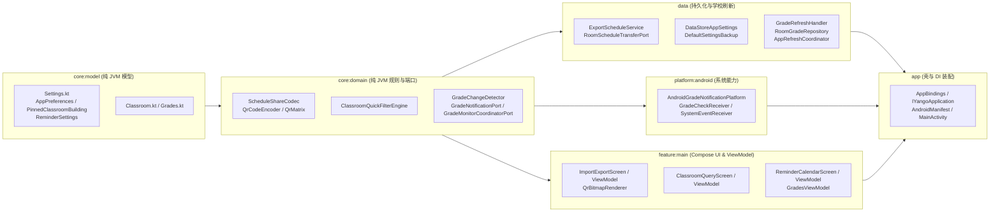

# 同班课表分享、空教室快捷筛选与新出分通知工程设计总览

> 状态：已实施并完成全模块单元测试、UI 测试与 Debug APK 编译验证。本文档组用于沉淀架构边界、数据契约、状态机、UI 极简规范与测试矩阵。

**目标：** 在保持现有架构边界与核心行为零破坏的前提下，为 iYango 补齐三项高频校园工具能力：同班课表口令 / 二维码分享、空教室快捷筛选与常用教学楼置顶、新出分变动通知与绩点变化摘要。

**架构：** 严格遵守 [ADR-002 模块依赖图](../adr/ADR-002-模块依赖图.md) 的单向依赖约束，即 `core:model` → `core:domain` → `data` / `platform:android` / `feature:main` → `app`。纯算法、编解码与差异检测沉淀在纯 JVM 模块 `core:domain`，持久化与教务聚合留在 `data`，Android 系统通知/闹钟/广播封装在 `platform:android`，Compose 状态与极简界面留在 `feature:main`，Hilt 绑定集中于 `app`。

---

## 1. 核查基线与全局约束

### 1.1 仓库与工具链基线

以下基线均于设计文档编写前对照源码逐项核实：

| 检查项 | 当前实际基线 | 依据文件 |
| --- | --- | --- |
| 日期与分支 | `2026-11-24`，分支 `iYango_prelease` | Git HEAD `b177e12adb1e0904d3db75a765adef06dad853ad` |
| 构建工具链 | AGP `9.4.0`（内置 Kotlin `2.4.21`）、KSP `2.3.12`、JDK 17 | `gradle/libs.versions.toml` |
| SDK 目标版本 | `compileSdk = 37`、`targetSdk = 36`、`minSdk = 26` | `app/build.gradle.kts` |
| 核心库版本 | Coroutines `1.11.0`、Serialization JSON `1.12.0`、Room `2.8.5`、DataStore `1.3.0` | `gradle/libs.versions.toml` |
| 第三方扩展依赖 | 未引入 ZXing / ML Kit / CameraX / WorkManager | `gradle/libs.versions.toml` |
| Room Schema 版本 | `@Database(..., version = 7, exportSchema = true)`（注：类注释历史文字仍提及 v5/v6，以注解 `version = 7` 为准） | `data/.../db/IYangoDatabase.kt` |
| 测试设施差异 | `core:domain`、`data`、`feature:main` 具备 `kotlinx-coroutines-test`；`platform:android` 仅依赖 `kotlinx-coroutines-core` 与 `robolectric = "4.17"`，需使用 `runBlocking` 与 `@Config(sdk = [35])` | 各模块 `build.gradle.kts` |

### 1.2 工程与设计红线

后续实施本组文档时，必须同时满足以下约束：

1. **界面与文案极简准则（源自项目 `AGENTS.md`）**：
   - **砍掉冗余文字**：三项新功能涉及的所有卡片、弹窗、筛选区与通知正文均不添加标语、引导性提示文字或次要说明标签。
   - **布局优先于解释**：例如教学楼置顶通过显性置顶图标与"常用教学楼"分区表达交互语义，不使用"长按可置顶"之类文字提示；空教室连空节次通过标签直观展示"连空 2 节"或"空至 17:20"。
   - **禁止圆点分隔**：任何界面文案、通知正文与状态摘要行之间禁止出现中圆点分隔符，多信息项统一改用换行、斜杠或空格排版。
2. **UX / DX / AX 同步提升与零破坏**：
   - **UX**：减少用户操作步数（一键口令导入、一键常用楼与此刻可用、后台自动出分直达成绩页）。
   - **DX**：时间比较全部注入 `java.time.Clock`，编解码、筛选投影、成绩差值计算全部落在纯 JVM 领域层，可不依赖 Android 框架做毫秒级单测。
   - **AX**：公开清晰、职责单一的领域端口与可序列化设置模型，避免隐藏在 UI 内部的状态耦合。
   - **零破坏**：既有 JSON 导入导出、教室查询/详情并发版本淘汰、成绩首次基线不标新、未读红点清除及系统提醒/日历主流程保持原语义不变。
3. **Room Schema 零迁移**：
   - 三项功能全部通过现有 v1 交换格式、Room 既有表结构与 DataStore `AppPreferences` / `ReminderSettings` 兼容扩展完成，**保持 `IYangoDatabase` `version = 7` 不变**，不新增数据库迁移脚本。

---

## 2. 子文档导航

| 功能编号 | 文档主题 | 交付范围摘要 | 文档入口 |
| --- | --- | --- | --- |
| 功能一 | 同班课表口令与二维码分享 | 紧凑 JSON + Deflate + Base64Url 口令编解码、零依赖纯 Kotlin QR 矩阵编码、白底二维码展示与 PNG 保存、剪贴板/文本提取预览闭环 | [同班课表口令与二维码分享工程设计](./2026-11-24-timetable-share-code-qr.md) |
| 功能二 | 空教室快捷筛选与常用教学楼置顶 | "此刻可用"时段解析与跨日联动、"连续空 2 节以上"连续空闲段算法、常用教学楼持久化与双触点快速定位 | [空教室快捷筛选与常用教学楼置顶工程设计](./2026-11-24-classroom-quick-filters.md) |
| 功能三 | 新出分变动通知与绩点变化 | 刷新前后增量 diff 与 GPA 差值计算、指纹去重与首次基线隔离、前后台触发与风控退避、隐私锁屏通知与独立渠道配置 | [新出分变动通知与绩点变化工程设计](./2026-11-24-grade-change-notification.md) |

---

## 3. 全局架构总览

---

## 4. 共享触点协调矩阵（防并行冲突）

当三项功能分批或多人并行开发时，以下共享文件必须由单一集成协调方统一合并，严禁直接互相覆盖：

| 共享文件 | 功能一触点 | 功能二触点 | 功能三触点 | 合并与兼容性要求 |
| --- | --- | --- | --- | --- |
| `core/model/.../Settings.kt` | 无 | `AppPreferences` 新增 `pinnedClassroomBuildings` 与 `sanitized()` 规范化 | `ReminderSettings` 新增 `gradeNotifyEnabled`、`gradeCheckIntervalHours`、`gradeNotifyHideScoreOnLockscreen` | 全部新增字段必须提供向后兼容默认值 |
| `data/.../repository/DataStoreAppSettings.kt` | 无 | `AppPreferencesDto` 新增对应可空回退默认字段与序列化 | `ReminderDto` 新增对应可空回退默认字段与序列化 | 依赖 `Json { ignoreUnknownKeys = true; encodeDefaults = true }` 保障旧 JSON 平滑反序列化 |
| `data/.../repository/DefaultSettingsBackup.kt` | 无 | `PreferencesDto` 导出/恢复 `pinnedClassroomBuildings` | `ReminderDto` 导出/恢复成绩通知设置 | 旧备份文件缺省这些键时，保留各自默认值不报错、不清空现有配置 |
| `app/.../di/AppBindings.kt` | 无新增绑定（复用 `ScheduleTransferPort`） | 无新增绑定（复用 `AppSettingsPort`、`Clock`） | 新增 `@Binds` 绑定 `GradeNotificationPort` 与 `GradeMonitorCoordinatorPort` | 保持 `@Singleton` 作用域与既有绑定风格一致 |
| `app/src/main/AndroidManifest.xml` | 无（使用既有 SAF 文档选择/保存） | 无 | 新增 `exported="false"` 的 `GradeCheckReceiver` 声明 | 复用既有 `POST_NOTIFICATIONS` 与 `RECEIVE_BOOT_COMPLETED` 权限 |
| `app/.../IYangoApplication.kt` | 无 | 无 | `onAppEnteredForeground()` 通知 `GradeMonitorCoordinatorPort` 评估前台静默检查 | 启动与前台回调不得阻塞主线程 |
| `platform:android/.../AndroidReminderPlatform.kt` (`SystemEventReceiver`) | 无 | 无 | 系统开机/package 替换/时区时间变更后重调度成绩周期检查 | 不破坏既有提醒与日历及桌面组件唤醒逻辑 |

---

## 5. 核心技术决策总表

| 维度 | 功能一（课表口令 / 二维码） | 功能二（空教室快捷筛选） | 功能三（新出分通知与 GPA） |
| --- | --- | --- | --- |
| 核心协议 / 算法 | `IYANGO-TT1:` 前缀 + 紧凑 v1 JSON + `Deflater(BEST_COMPRESSION)` + URL-safe Base64；解码后直接复用 `ScheduleTransferPort.read(bytes)` | `Clock` 注入校准本地时间；解析 `ClassroomPeriodGroup` 时钟确定当前/下一时段；连续索引扫描计算连空段 | 落库前后快照差值对比 + `"stableKey\|scoreText"` 本地指纹去重；复用 `GradeStatisticsCalculator.calculate` 算学期 GPA 差值 |
| 第三方依赖策略 | 零新依赖：在 `core:domain` 实现纯 Kotlin ISO 18004 Byte Mode QR 编码器，避免引入 ZXing 破坏镜像可构建性 | 零新依赖 | 零新依赖：优先采用 `AlarmManager` 非精确周期唤醒，暂不引入 WorkManager |
| 隐私与安全边界 | 导出时剥离 `displayConfig`（个人配色/壁纸）、本地视图状态与教务凭证；流式解压设 512 KB 上限防压缩炸弹 | 纯本地计算过滤与排序；置顶列表为普通教学楼索引，无敏感凭据 | 通知默认 `VISIBILITY_PRIVATE` + 锁屏脱敏 `publicVersion`；未登录/首次同步基线静默不弹窗；会话失效即停止后台唤醒防风控 |
| 极简 UI 呈现 | 分享弹窗强制纯白不透明底 + 黑模块二维码，不随暗色模式与液态玻璃反色；导入弹窗粘贴即走现有预览确认页 | 常用教学楼行在顶部一键直达；`RoomCard` 直接展示状态胶囊如"连空 2 节""空至 17:20" | 通知使用多行正文无圆点分隔；点击直达成绩页 `iyango://open/grades`（Tab 2）；设置放在现有提醒与日历页 |

---

## 6. 建议实施顺序与里程碑

1. **阶段 0：共享模型与持久化基线冻结**
   - 在 `Settings.kt`、`DataStoreAppSettings.kt`、`DefaultSettingsBackup.kt` 一次性落齐功能二与功能三的设置字段与设置备份编解码。
   - 验证旧版 DataStore JSON 与旧版设置备份文件的反序列化兼容性单测通过。
2. **阶段 1：纯 JVM 领域核心实现（可并行）**
   - 功能一：`ScheduleShareCodec`、`QrCodeEncoder`、`QrMatrix` 及全面 JVM 单测。
   - 功能二：`ClassroomQuickFilterEngine`、`PinnedClassroomBuilding` 排序合并逻辑及固定 `Clock` JVM 单测。
   - 功能三：`GradeChangeDetector`、`GradeNotificationPorts` 与 GPA 差值单测。
3. **阶段 2：数据层与平台适配实现**
   - 功能一：`ExportScheduleService.exportCompactJson` 与 `ScheduleTransferPort` 扩展。
   - 功能三：`GradeNotifiedStore`、`GradeRefreshHandler` 通知钩子、`DefaultGradeMonitorCoordinator`、`AndroidGradeNotificationPlatform`、`GradeCheckReceiver` 与 `AppBindings` 绑定。
4. **阶段 3：界面接入与极简文案收敛**
   - 功能一：`ImportExportViewModel` / `ImportExportScreen` 口令二维码收发弹窗及可选课表管理页入口。
   - 功能二：`ClassroomViewModel` 与 `ClassroomQueryScreen` 快捷筛选与常用楼置顶交互。
   - 功能三：`ReminderCalendarViewModel` / `ReminderCalendarScreen` 出分通知配置卡，以及 `GradesViewModel` 进页消通知。
5. **阶段 4：全量回归与真机闭环验收**

---

## 7. 后续实施验证命令清单

后续进入实施阶段后，应在仓库根目录 `g:\code\Android\iYango` 使用项目现有 JDK 17 与 Gradle Wrapper 执行以下命令验证各阶段交付，不把静态阅读替代真实执行：

| 验证范围 | 执行命令 | 验证重点 |
| --- | --- | --- |
| 纯 JVM 模型与领域规则 | `.\gradlew.bat :core:model:test :core:domain:test --console=plain` | 分享口令编解码、QR 矩阵编码与纠错、空教室连续段算法、成绩增量与 GPA 差值计算 |
| 数据层与持久化兼容 | `.\gradlew.bat :data:testDebugUnitTest --console=plain` | 紧凑课表导出往返、DataStore 新字段默认值、旧备份恢复兼容、`GradeRefreshHandler` 仅刷新不重复弹窗 |
| 平台系统集成（Robolectric） | `.\gradlew.bat :platform:android:testDebugUnitTest --console=plain` | 成绩通知渠道与隐私锁屏 `publicVersion`、跳转 Intent Tab 2、周期闹钟触发与账号隔离清理 |
| 页面 ViewModel 与 Compose UI | `.\gradlew.bat :feature:main:testDebugUnitTest --console=plain` | 口令导入预览串联、二维码对比度绘制、此刻可用与常用楼状态机、出分通知设置交互 |
| 宿主集成与 Debug 包编译 | `.\gradlew.bat :app:testDebugUnitTest :app:assembleDebug --console=plain` | Hilt 依赖图、`AndroidManifest` 接收器声明、完整 Debug APK 产线检查 |
