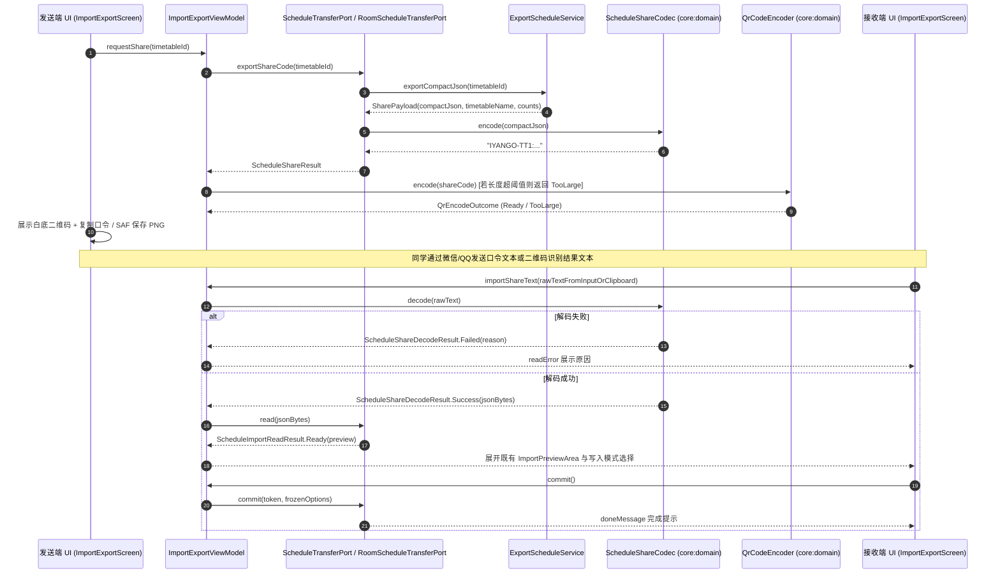

# 功能一工程设计：同班课表口令与二维码分享

> 状态：已实施并完成单元测试与 UI 回归验证。文档内架构契约与实际源码实现保持一致。

**目标：** 让同班或同校同学无需登录对方教务账号，也不依赖本地 JSON 文件互传，直接通过「短口令文本」或「二维码图片」在 10 秒内把整份课表（含课程、学期锚点、作息时间表）无损导入 iYango，并复用既有的预览、多选、新建/追加/替换与重复检测体系。

**模块覆盖：** `core:domain`、`data`、`feature:main`（**不修改** `core:model`、`platform:android` 与 Room 数据库 Schema）。

---

## 1. 现状核查与可复用底座

### 1.1 已有基础设施

| 组件 / 文件 | 现有能力 | 本功能复用点 |
| --- | --- | --- |
| `core/domain/.../LiquidGlassShareCodec.kt` | 使用 `Deflater(Deflater.BEST_COMPRESSION)` + URL-safe Base64（无 padding）+ `IYANGO-GLASS-V1:` 前缀 + 有上限 `Inflater` 解压 + 正则从聊天文本提取口令 | 直接沿用同等「压缩编码 + 有上限流式解压 + 聊天文本正则提取 + 剪贴板粘贴」工程范式 |
| `core/domain/.../TransferPorts.kt` | `ScheduleTransferPort` 已定义 `export(timetableId)`、`read(bytes)`、`inspectTarget(timetableId)`、`commit(token, options)` 及完整写入模式枚举 `ImportWriteMode`（`CREATE` / `APPEND` / `REPLACE`） | 解码后的字节流直通 `ScheduleTransferPort.read(bytes)`，100% 复用现有校验、选课、写入与回滚逻辑 |
| `data/.../json/ExportScheduleService.kt` 与 `JsonDto.kt` | 导出标准 v1 `ScheduleJsonDocument`（`meta`/`courses`/`semester`/`timeSlots`/`displayConfig`），主动剔除本机视图状态 `sourceStartSection`/`sourceEndSection` 与 `timetableId` | 复用同源 v1 交换模型与校验规则，保持与既有 JSON 导入解析器互通 |
| `data/.../json/ScheduleJsonParser.kt` 与 `ImportScheduleService.kt` | 宽容解析 JSON，生成 `rowKey` 与基于 SHA-256 的 `fileDigest` 去重指纹，禁止覆盖 `source != "LOCAL"` 的教务绑定课表 | 口令导入自动继承重复文件二次确认、课程单条勾选与教务课表保护机制 |
| `feature/main/.../importexport/ImportExportViewModel.kt` 与 `ImportExportScreen.kt` | 已有 `ImportPreviewArea` 预览区、`confirmDuplicate` 对话框、`busy`/`readError`/`doneMessage` 状态流 | 在现有页面最小化增设「口令导入」「分享口令 / 二维码」入口，导入成功后复用同一预览区提交 |
| `feature/main/.../settings/LiquidGlassSettingsScreen.kt` | 已建立使用系统 `ClipboardManager` 读写剪切板的惯例 | 复用系统 `ClipboardManager` 服务获取与异常安全降级 |

### 1.2 核查发现的关键设计约束

1. **`ScheduleJsonParser` 对省略默认字段的敏感性（关键坑点）**：
   - 核查 `ScheduleJsonParser.kt` 的 `readCourse`、`readTimeSlots` 发现：解析器使用 `Json.parseToJsonElement` 读取字段时，对于缺省键按 `0` 处理后触发修正警告甚至改写数值：
     - `ScheduleJsonCourse` 模型中 `dayOfWeek = 1`、`startSection = 1`、`endSection = 1`、`startWeek = 1`、`endWeek = 18`、`ScheduleJsonTimeSlot.section = 1`。
     - **若直接对 `ScheduleJsonDocument` 开启 `Json { encodeDefaults = false }`**，会导致周一第 1 节课程省略 `dayOfWeek`/`startSection`/`endSection` 并弹出误导性解析提示；更严重的是 `startWeek = 5, endWeek = 18` 会因 `endWeek` 等于默认值而被省略，解析器 `weekEnd = item.num(...) ?: 0` 后回退为 `weekEnd = weekStart = 5`，造成**数据静默截断**；而 `section = 1` 的作息行被省略后会被解析器以「跳过不完整的节次时间记录」直接丢弃！
   - **解决策略**：分享导出专用的紧凑 JSON 构造 **必须显式保留核心调度必填键**（`meta`、课程 `name`/`dayOfWeek`/`startSection`/`endSection`/`startWeek`/`endWeek`/`weekType`、`semester`、`timeSlots[].section`/`startTime`/`endTime`），仅在无损等价前提下省略空扩展字段与缩进空格，且置 `displayConfig = ""`。
2. **`gradle/libs.versions.toml` 无第三方扫码 / 二维码库**：
   - 项目当前未引入 `com.google.zxing:core`、ML Kit 或 CameraX，且版本目录注明依赖均针对阿里云 Maven 镜像逐项核对，不随功能随便添加动态依赖。
   - 因此本方案设计优先在 `core:domain` 提供**零依赖纯 Kotlin QR 矩阵编码器**，接收端首期通过「剪贴板 / 聊天整段文本识别」零权限闭环。
3. **跨口令误粘贴区分**：
   - 已有液态玻璃方案口令前缀为 `IYANGO-GLASS-V1:`（正则 `IYANGO-GLASS-V1:([A-Za-z0-9_-]+)`），新课表口令需采用清晰区分的前缀，并在解码失败时精准识别误贴的玻璃参数口令。

---

## 2. 总体架构与数据流



---

## 3. 口令协议与安全性设计 (`ScheduleShareCodec`)

### 3.1 口令格式定义

- **前缀与版本标识**：`IYANGO-TT<version>:<payload>`，当前版本前缀常量为 `IYANGO-TT1:`。
- **有效载荷构造**：
  $$\text{payload} = \text{Base64UrlNoPadding}\Big(\text{Deflate}_{\text{BEST\_COMPRESSION}}\big(\text{UTF-8}(\text{CompactScheduleJsonV1})\big)\Big)$$
- **整段文本提取正则**：
  - `Regex("IYANGO-TT(\\d+):([A-Za-z0-9_-]{16,})")`
  - 当用户从 QQ / 微信整段复制类似`"这是这学期课表 IYANGO-TT1:eJz... 发你了"`的消息时，自动忽略前后的聊天文字、换行符与标点，精准抽出版本号与主体编码串；若文本中存在多段匹配，默认取第一段有效匹配。

### 3.2 紧凑载荷裁剪规则与体积测算

在 `ExportScheduleService` 中新增 `exportCompactSchedule(timetableId: Long): ShareExportPayload`（不改动既有给 JSON 备份使用的 `export()`）：

1. **剥离个人化与本机视图状态**：
   - `displayConfig` 强制输出为空串 `""`：发送方的网格颜色覆盖、自定义壁纸设置、字体字号偏好**绝不污染**接收方课表显示设置。
   - 保持既有过滤规则：剔除 `sourceStartSection`、`sourceEndSection`、`timetableId`，不含任何教务账号或会话 Cookie。
2. **紧凑序列化结构**：
   - 关闭 JSON 美化缩进与换行（单行输出）。
   - 核心调度键始终显式输出，避免 `ScheduleJsonParser` 出现缺省值修正或截断风险：
     - `meta`: `{"app":"ClassSchedule","version":1,"exportedAt":"..."}`（或按紧凑 `CompactJson` DTO 对必填属性移除默认值使 `kotlinx.serialization` 在 `encodeDefaults = false` 时依然恒定输出）。
     - 每门 `course`: 必含 `name`、`dayOfWeek`、`startSection`、`endSection`、`startWeek`、`endWeek`、`weekType`；仅在非默认值/非空时输出 `id`（有调课引用 `overrideOfId > 0` 时必需保留 `id`）、`teacher`、`classroom`、`remark`、`color`（非默认 `#0A59F7` 时输出）、`credit`（`> 0`）、`isOutdoor`（`true`）、`enabled`（`false`）、`selectedWeeks`、`timeMode`（`!= 0`）、`startTime`/`endTime`/`date`（非空）、`cycleLength`（`> 1`）、`cycleWeek`（`> 0`）、`overrideOfId`（`> 0`）、`overrideWeek`（`> 0`）。
     - `semester`: 非空时输出 `name`、`startDate`、`totalWeeks`、`isCurrent`。
     - `timeSlots`: 每条必含 `section`、`startTime`、`endTime`；可选保留 `name`、`kind`（`!= 0`）、`hidden`（`true`）、`defaultCourseName`、`sortOrder`（`!= 0.0`）。
3. **体积估算（典型 25 至 30 门课 + 11 节作息 + 1 个学期）**：
   - 现有 `export()` 美化 JSON：约 18 KB 至 24 KB。
   - 紧凑单行 JSON：约 4.2 KB 至 6.0 KB（减少约 75%）。
   - `Deflate(9)` 压缩后：约 700 字节至 1,150 字节。
   - Base64Url 编码并附加 `IYANGO-TT1:` 前缀：约 **950 至 1,550 字符**，满足社交软件直接粘贴与中大型二维码容量要求。

### 3.3 防御性与容错边界

`ScheduleShareCodec` 在纯 JVM 的 `core:domain` 中独立实现，包含以下安全闸口：

| 防线 | 限制常量 / 判定条件 | 返回错误码 (`ScheduleShareDecodeError`) |
| --- | --- | --- |
| 空输入拦截 | `raw.isBlank()` | `EMPTY_INPUT` |
| 错贴外观口令识别 | 未匹配 `IYANGO-TT` 且包含 `IYANGO-GLASS-V` | `WRONG_CODE_KIND_LIQUID_GLASS` |
| 无效口令识别 | 无法匹配 `TOKEN_REGEX` | `INVALID_FORMAT` |
| 版本前向兼容拒绝 | 解析版本号 `version != 1`（如未来 v2 口令给旧版本端导入） | `UNSUPPORTED_VERSION` |
| 编码长度上限 | Base64Body 长度不在 `16..MAX_ENCODED_CHARS`（`32_768`） | `PAYLOAD_TOO_LARGE` / `INVALID_FORMAT` |
| 压缩炸弹与 OOM 防护 | 流式 `Inflater` 解压累加字节超过 `MAX_DECOMPRESSED_BYTES`（`512 * 1024`）立刻中止并释放 `end()` | `PAYLOAD_TOO_LARGE` |
| 解码损坏校验 | Base64 字符非法或 `Inflater` 抛出 `DataFormatException` 或 UTF-8 非合法 JSON 根结构 | `CORRUPTED_DATA` |

---

## 4. 二维码方案与选型分析

### 4.1 依赖与编码方案对比

| 维度 | 方案 A（推荐）：`core:domain` 纯 Kotlin ISO 18004 Byte Mode QR 编码器 | 方案 B：引入 `com.google.zxing:core` |
| --- | --- | --- |
| 构建与镜像风险 | 零第三方依赖，`libs.versions.toml` 无需改动，纯离线可编译通过 | 需验证阿里云镜像可用性，并增配 R8 `rules.keep` 检查 |
| 代码体量与可控性 | 仅需实现 QR Byte Mode（Version 1 至 40，EC Level L / M），核心 Galois Field $\text{GF}(2^8)$ 与 Reed-Solomon 纠错、掩码评分约 350 至 450 行 | 全包体积较大，包含大量一维码与解码冗余代码 |
| 可测试性 | 纯 JVM `QrCodeEncoder` 输出布尔二维矩阵 `QrMatrix(size, modules)`，无需 Robolectric 即可验证格式信息、版本与可扫码性 | 可测，但引入外部二进制黑盒 |
| 结论 | **采用方案 A** 负责生成端 QR 矩阵 | 保留为未来若需接入「从相机 / 相册扫二维码解码」时的统一编解码备选 |

### 4.2 扫码兼容性与容量分级策略

1. **内容载体选择**：二维码直接编码纯文本口令 `IYANGO-TT1:...`，而不是 `iyango://open/import?code=...` 自定义 URI。原因：
   - Android Intent / DeepLink 在不同国产定制系统及微信内置浏览器下常被拦截。
   - 使用纯文本口令时，即便接收方先用微信扫一扫或系统相机扫描二维码，也能直接看到并点击复制整段 `IYANGO-TT1:...`，再回 iYango 一键粘贴导入，形成**零相机权限的跨应用容错闭环**。
2. **动态纠错等级与容量阈值**（ISO/IEC 18004 Byte 模式理论上限为 Version 40 EC-L 的 2,953 字节）：

| 口令 UTF-8 字节长度 | 选定纠错等级 | 预计 QR 版本区间 | 界面呈现策略 |
| --- | --- | --- | --- |
| `<= 800` 字节 | `ErrorCorrection.M` | Version 1 至 22 | 正常展示二维码（高容错、屏幕直扫秒出） |
| `801 .. 1,600` 字节 | `ErrorCorrection.L` | Version 20 至 29 | 正常展示二维码（均衡密度，推荐导出高清图发群） |
| `1,601 .. 2,400` 字节 | `ErrorCorrection.L` | Version 30 至 37 | 展示二维码并提供「保存高清图片」与「复制口令」，避免小屏幕相机失焦 |
| `> 2,400` 字节（极庞大多周调整课表） | 不生成过密矩阵 | 返回 `TooLarge` | 隐藏二维码区域仅展示口令文本与「复制口令」，同时支持导出 `.json` 文件 |

### 4.3 渲染与保存硬约束（物理可读性优先）

- **强制白底黑码**：无论应用当前处于浅色模式、深色模式还是全局液态玻璃壁纸背景，二维码容器内部（包含外围 **4 个模块宽度的 Quiet Zone 静区**）必须使用**纯白不透明背景 `#FFFFFFFF`** 与**纯黑前景 `#FF000000`**。
  - **严禁**对二维码使用半透明玻璃折射底层、暗色模式颜色反转（部分国产扫码器反白识别率极差）或圆角过度裁剪侵占 Quiet Zone。
- **屏幕弹窗显示**：在 Compose 中通过 `Canvas` 按整数像素缩放绘制模块，避免双线性插值导致边缘模糊。
- **离屏高清 PNG 保存**：独立函数在后台线程按至少 `size = 1080` px（每模块整数像素放大）将 `QrMatrix` 绘入 `Bitmap.Config.ARGB_8888`，复用现有 SAF `ActivityResultContracts.CreateDocument("image/png")` 保存为本地图片；若写入失败需清除未完成文档（沿用 `ScheduleExportScreen.kt` 现有模式）。

### 4.4 接收端演进分期

- **第一阶段（本设计交付范围，零权限依赖）**：在导入弹窗与输入区通过系统 `ClipboardManager` 识别或用户手动粘贴聊天全文/扫码文本，立即调用 `ScheduleShareCodec.decode`，直达现有课程勾选与写入模式预览。
- **第二阶段（可选后续演进）**：在需要内置「从相册识别二维码图 / 直接打开相机扫码」时，再评估按需引入 ZXing 解码或系统扫码能力，届时共享同一套 `ScheduleShareCodec` 解析入口，不返工业务层。

---

## 5. 各模块接口设计与职责划分

### 5.1 `core:domain` 新增契约（纯 JVM）

建议新增文件：
- `core/domain/src/main/kotlin/com/gfs/iyango/core/domain/ScheduleShareCodec.kt`
- `core/domain/src/main/kotlin/com/gfs/iyango/core/domain/QrCodeEncoder.kt`
- 更新 `core/domain/src/main/kotlin/com/gfs/iyango/core/domain/TransferPorts.kt`

接口与数据结构设计契约（尚未落盘）：

```kotlin
package com.gfs.iyango.core.domain

object ScheduleShareCodec {
    const val PROTOCOL_HEAD = "IYANGO-TT"
    const val CURRENT_VERSION = 1
    const val PREFIX_V1 = "IYANGO-TT1:"
    const val MAX_ENCODED_CHARS = 32_768
    const val MAX_DECOMPRESSED_BYTES = 512 * 1024

    fun encode(compactScheduleJson: String): String
    fun decode(rawInput: String): ScheduleShareDecodeResult
    fun containsPotentialToken(rawInput: String): Boolean
}

enum class ScheduleShareDecodeError {
    EMPTY_INPUT,
    INVALID_FORMAT,
    WRONG_CODE_KIND_LIQUID_GLASS,
    UNSUPPORTED_VERSION,
    CORRUPTED_DATA,
    PAYLOAD_TOO_LARGE,
}

sealed interface ScheduleShareDecodeResult {
    data class Success(val jsonBytes: ByteArray, val version: Int) : ScheduleShareDecodeResult
    data class Failed(val error: ScheduleShareDecodeError, val message: String) : ScheduleShareDecodeResult
}

enum class QrErrorCorrectionLevel { L, M }

data class QrMatrix(
    val size: Int,
    val modules: BooleanArray, // 长度 = size * size，true 表示黑色前景模块
    val version: Int,
    val correctionLevel: QrErrorCorrectionLevel,
) {
    fun isDark(x: Int, y: Int): Boolean = modules[y * size + x]
}

sealed interface QrEncodeResult {
    data class Ready(val matrix: QrMatrix) : QrEncodeResult
    data class TooLarge(val byteCount: Int, val maxBytes: Int) : QrEncodeResult
}

object QrCodeEncoder {
    const val PRACTICAL_MAX_BYTES = 2_400
    fun encode(text: String): QrEncodeResult
}
```

`TransferPorts.kt` 扩展示意图（在 `ScheduleTransferPort` 中提供默认或必需实现）：

```kotlin
data class ScheduleShareExportResult(
    val shareCode: String,
    val timetableName: String,
    val courseCount: Int,
    val timeSlotCount: Int,
    val byteLength: Int,
)

// 在 ScheduleTransferPort 接口内追加：
suspend fun exportShareCode(timetableId: Long): ScheduleShareExportResult
```

### 5.2 `data` 层改造清单

- **修改 `data/.../json/ExportScheduleService.kt`**：
  - 保留原有 `export(timetableId, displayConfig)`（用于 JSON 文件备份导出，格式与 `prettyPrint` 行为不变）。
  - 新增 `exportCompactScheduleJson(timetableId: Long): ExportResult`：
    - 复核空课表校验（无课程抛出同既有异常`"本机还没有课程，无法导出"`）。
    - 构造不含美化缩进与 `displayConfig` 的安全紧凑 v1 JSON 文本（所有必填调度键恒定序列化，扩展零值/空字符串选择性省略）。
- **修改 `data/.../repository/TransferPortImpl.kt` (`RoomScheduleTransferPort`)**：
  - 实现 `exportShareCode(timetableId)`：调用 `exportService.exportCompactScheduleJson(timetableId)`，再经 `ScheduleShareCodec.encode(result.json)` 组装 `ScheduleShareExportResult`。
  - 现有 `read(bytes)`、`inspectTarget(timetableId)`、`commit(token, options)` **零修改**。

### 5.3 `feature:main` 层设计与极简界面规范

- **修改 `feature/main/.../importexport/ImportExportViewModel.kt`**：
  - 新增状态字段：`shareSession: StateFlow<ShareDialogState?>`（包含课表名、课程数、作息节数、口令字符串、以及 `QrEncodeResult`）。
  - 新增动作：
    - `requestShareCurrent()` / `requestShareTimetable(timetableId: Long)`：加载目标课表并生成口令与 `QrMatrix`。
    - `dismissShare()`：关闭分享弹窗。
    - `importFromShareText(rawText: String)`：调用 `ScheduleShareCodec.decode(rawText)`；失败则写入可读误区提示至 `readError`（如识别到 `IYANGO-GLASS-V` 时提示“这是液态玻璃外观口令，请前往外观设置导入”）；成功则直接把 `jsonBytes` 交给 `transfer.read(jsonBytes)` 进入现有预览状态，与 JSON 文件导入合流。
- **修改 `feature/main/.../importexport/ImportExportScreen.kt`**：
  - **遵循 `AGENTS.md` 极简布局**：
    - 「导入」卡片增加按钮：「从分享口令导入」（`LiquidOutlinedButton`），位置紧接「AI 拍图 / 文本导入」「从 JSON 文件导入」之后。
    - 「导出」卡片增加按钮：「分享口令 / 二维码」（`LiquidButton` 或 `LiquidOutlinedButton`），与「导出课表图片 / ICS」「导出 JSON 备份」并列。
  - **分享课表弹窗 (`ShareTimetableDialog`)**：
    - 标题：`分享课表`
    - 摘要信息：两行纯文本展示课表名与数量统计（**严禁使用中圆点分隔**，例如第一行显示课表名，第二行显示 `课程 24 条 作息 11 节`）。
    - 中央二维码区（当 `QrEncodeResult.Ready` 时）：固定纯白圆角底卡片内留足静区边距，绘制黑白高清二维码矩阵；若返回 `TooLarge`，不渲染模糊二维码，仅保留紧凑区域显示提示 `课程数量较多，建议使用口令分享`。
    - 操作区：`保存图片`（触发 SAF PNG 导出）与 `复制口令`（写入 `ClipboardManager` 并反馈完成提示）。
  - **口令导入弹窗 (`ImportShareCodeDialog`)**：
    - 单一文本输入框（可多行，支持直接把同学发来的包含前后聊天文本的消息整段粘贴进去），`placeholder` 仅简洁标注 `IYANGO-TT1:...`（不加冗余引导标语）。
    - 底部左侧提供`读取剪贴板`快捷填充，右侧`取消`与`解析预览`；解析成功后弹窗自动关闭，画面平滑下滚并高亮展示既有 `ImportPreviewArea`。
- **可选增强入口（`feature/main/.../timetable/TimetableManageScreen.kt` 与 `TimetableManageViewModel.kt`）**：
  - 若需支持直接在「课表管理」页分享任意非当前课表，可在单张 `TimetableCard` 的 `ActionPill` 行增加 `分享` 胶囊，弹出同一套 `ShareTimetableDialog`，复用同一编解码与渲染组件（新增 `feature/main/.../importexport/QrCodeBitmapRenderer.kt` 与 `TimetableShareDialog.kt` 供两处共用）。

---

## 6. 边界条件与极端场景设计

| 边界场景 | 预期行为 |
| --- | --- |
| 发送方课表为空（0 门课） | `exportCompactScheduleJson` 沿用既有异常阻止生成空口令，界面直接提示 `"本机还没有课程，无法导出"` |
| 课表内含单双周、指定周 `selectedWeeks`、单次调课 `overrideOfId` | 因保持文件内 `id` 映射与 `overrideOfId`/`overrideWeek` 并走 `ImportScheduleService.insertCourses` 原管线，调课关联关系完整重映射保留 |
| 接收方重复导入同一口令或同内容文件 | 因最终转入 `ScheduleTransferPort.read` 并对标准化 JSON 字节算 SHA-256 存入 `import_record`，自动触发 `confirmDuplicate` 二次确认弹窗 |
| 接收方目标课表是 `source != "LOCAL"` 的教务同步课表 | 保留既有限制：只允许「新建课表导入」，不允许追加或替换教务同步课表 |
| 用户误将微信发来的 `IYANGO-GLASS-V1:...` 玻璃口令贴入课表口令框 | `ScheduleShareCodec.decode` 返回 `WRONG_CODE_KIND_LIQUID_GLASS`，界面明确提示前往外观设置导入，不报模糊 JSON 错误 |
| 剪贴板为空或系统限制后台读取剪贴板失败 | 捕获 `SecurityException` 与空值，按钮静默不闪退并保持输入框焦点可供用户手动长按粘贴 |
| 极端恶意或损坏的口令导致 Inflater 膨胀失控 | 解压输出累计达到 `512 KB` 立即中止解压并释放原生 zlib 资源，阻断 OOM 与压缩炸弹 |
| 手机处于深色模式或开启强半透明液态玻璃 | 二维码白底黑码独立隔离主题反色与玻璃模糊背景，保证静区与模块对比度 `>= 21:1` |

---

## 7. 测试矩阵与验收标准

### 7.1 单元测试与 UI 测试清单

| 模块 | 建议测试文件 | 核心覆盖断言 |
| --- | --- | --- |
| `core:domain` | `ScheduleShareCodecTest.kt` | 正常往返编解码、聊天噪声前后文本精确提取、压缩体积比、14 种异常口令（截断/非法字符/版本号=99/玻璃口令误贴/超 512KB 解压炸弹）精准错误码 |
| `core:domain` | `QrCodeEncoderTest.kt` | 常见长度（200B / 900B / 1,500B / 2,400B）矩阵维度与 Finder Pattern 定位角正确性、`> 2,400B` 准确返回 `TooLarge`、EC-M 到 EC-L 自动降档边界 |
| `data` | `ScheduleShareExportIntegrationTest.kt` | 含周一第 1 节、`endWeek=18`、`timeSlots[].section=1`、单双周、自选周、调课覆盖、自定义作息的课表导出为口令并解码送回 `ImportScheduleService.read` 与 `commit` 后，数据库课程与作息 100% 相等且 `issues` 数为 0，`displayConfig` 不被覆盖 |
| `feature:main` | `ImportExportShareViewModelTest.kt` | 分享口令与 QR 状态生成、误贴口令错误信息、成功解码直通既有 `preview` 与 `confirmDuplicate` 流程 |
| `feature:main` | `QrBitmapRendererTest.kt`（Robolectric） | 生成位图四角静区全为 `Color.WHITE`、模块像素严格二值不发虚 |

### 7.2 功能验收标准（Definition of Done）

- [ ] 发送方 30 门课的完整课表生成的口令长度稳定控制在一屏可读范围内，不含个人壁纸与显示覆盖设置。
- [ ] 从包含聊天前后冗余文字的整段消息中可以直接识别并提取 `IYANGO-TT1:` 口令，无缝接入原有 `ImportPreviewArea`。
- [ ] 二维码弹窗与导出 PNG 在浅色和深色模式下均保持纯白不透明底色 + 纯黑模块 + 四周完整静区，真机可用系统相机与微信扫一扫识别出口令全文。
- [ ] 既有 JSON 文件备份/导入、AI 导图/文本导入、ICS/图片导出全部功能零退化。
